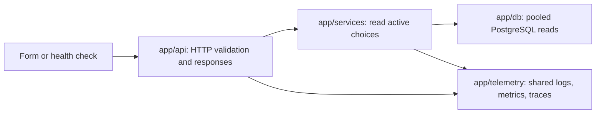

# Initial API design

Design status: **proposed architecture for review**, retaining the product and
HTTP requirements already recorded in issues #12–15. New technical mechanisms
and private-route contracts require review; existing approvals are not reopened.

Implementation status: **Partially implemented**. The FastAPI application,
shared response and error behavior, and `GET /health/live` exist (issue #12).
`GET /health/ready` exists (issue #13). The lookup endpoints are not
implemented yet.

Related context: [system overview](../architecture/overview.md),
[database design](../database/design.md), [ER diagram](../database/er-diagram.mmd),
[observability design](../architecture/observability.md), and
[backend setup](../setup/backend.md). The owner's later approved workout
choices and proposed contracts are in [workout API design](workouts.md).
The [API index](README.md) maps all open API issues and #30 to their canonical
designs; [exercise APIs](exercises.md) cover provider search and custom creation.

## Start with user actions

The first slice lets a participant check the backend and lets a future exercise
form load its category and body-part choices. It does not yet save an exercise.
The other actions below show the next design steps, not approved API contracts.

| Person's action | API responsibility | Design stage and dependency |
|---|---|---|
| Check whether the backend is running | Answer without depending on PostgreSQL | Detailed below |
| Check whether the backend can read the application database | Check the database and required reference tables | Detailed below; needs migrated tables |
| Open the New exercise form | Load active categories and body parts | Detailed below; needs approved seeds |
| Browse or search exercises | Return provider exercises and only this user's private exercises | Later; needs verified identity, provider mapping, and search rules |
| Save a custom exercise | Save name, category, body part, and creator together | Later; needs verified identity and approved database enforcement |
| Create or change a workout template | Save an ordered plan with at least one exercise and at least one valid set per included exercise | Approved completeness; proposed API in workouts.md |
| Start a workout from a template or without one | Capture a complete starting plan without changing the source | Later; one active workout is approved; ad hoc request details remain open |
| Record a set and start rest | Save actual performance and start rest once, including on retry | Later; follow approved measurement rules and decide timer changes |
| Finish a workout | Save history, then handle the explicit template-update choice | Later; needs update mapping, conflict, and retry decisions |
| Cancel an active workout | Warn that Discard deletes completed draft work; Save retains completed sets and cancels unfinished sets | Later; proposed contract and migration in [workouts.md](workouts.md) |
| Review workout history and previous performance | Read the user's preserved workout records | Later; needs history matching and correction decisions |

Google/Microsoft sign-in is a confirmed requirement, but token validation,
application sessions, and account linking still need their own design. A
user ID in a header, request body, or development setting is not authentication.
Bodyweight may use duration instead of reps after a new database migration.
The current migration still treats Bodyweight as reps only. These approved
rules do not change the four initial, read-only endpoint contracts below.

## Proposed endpoint summary

| Method and path | Caller | Successful result |
|---|---|---|
| `GET /health/live` | Participant or process monitor | `200`: backend process can answer |
| `GET /health/ready` | Participant or readiness monitor | `200`: database and reference-table reads work |
| `GET /api/v1/exercise-categories` | Future New exercise form | `200`: ordered, active category choices |
| `GET /api/v1/body-parts` | Future New exercise form | `200`: ordered, active body-part choices |

All four are read-only. They do not create a database, tables, seeds, users, or
workouts. PostgreSQL container health, application readiness, and a verified
migration revision are separate checks; none substitutes for the others.

## Common request and response rules

Issue #12's common response behavior and liveness are implemented. The same
requirements apply to proposed foundation endpoints; additional private-route
transport choices remain proposals. The following no-input rules apply to the
four foundation GET routes, not to every later API's declared body/query fields:

- Use `/api/v1` for application APIs; keep operational health paths unversioned.
- No sign-in is required for these four non-personal health/lookup endpoints,
  as specified in their stories. This grants no access to private data or
  permission to expose a deployment publicly. Private APIs need the identity
  boundary described below.
- Requests have no body, path parameters, or supported query parameters.
  Reject a nonempty body or any query parameter with `422 invalid_request`.
  Do not add filtering, pagination, or an inactive-record option in this slice.
- Responses use `application/json` and `Cache-Control: no-store`. Avoid client
  caching initially so changed choices appear on the next form load.
- Generate an opaque UUID request ID for each request. Return it in
  `X-Request-ID` on successes and errors; also include it in error JSON. It is
  for support and future safe log correlation, never authorization. Returning
  an ID does not mean current server tracebacks contain it. Do not trust incoming
  request IDs as identity or confuse them with OpenTelemetry trace IDs.
- An item has exactly `id` (integer), `name` (string), and `sort_order`
  (integer). Return stable database IDs; callers must not use names as keys.
  Display names can change without changing the record's identity.
- GET requests must not write data. Repeated requests do not duplicate seeds.

Application paths match exactly: slash variants use safe JSON 404 rather than
empty redirects. Built-in `/docs` serves HTML; it is not an application JSON
endpoint. Every JSON response uses the shared headers. Application errors use
one envelope; future dependency errors must be registered in OpenAPI explicitly,
not assumed to appear automatically from exception handlers.

### Private access and error boundary

**Proposal for all #21–29 private routes:** validate Google/Microsoft issuer,
signature, audience, expiry and stable subject at a separately approved identity
boundary. Resolve that verified identity to the application's user; never use a
submitted user ID, request ID, CORS origin, email alone or development header as
proof. Account linking, bearer versus application-session transport, refresh/
revocation and any additional session storage remain D8 in the
[decision table](workouts.md#owner-decisions-and-approval-checklist). Existing
`users`/`user_identities` do not implement sign-in by themselves.

The trusted service supplies the verified user to database operations; clients
do not connect to PostgreSQL. Filter/lock by that owner in every private read
and write, including child resources and bulk plan entries. Do not first reveal
a foreign row and reject it afterward. Proposed error rule: unauthenticated
requests use `401 authentication_required`; unknown and inaccessible private
IDs share `404 not_found` without revealing their existence. A request-supplied
owner field is unsupported input, not a way to select a different identity.
If cookie sessions are chosen, specify CSRF/origin protection as part of that
auth design; CORS does not substitute for either authentication or CSRF control.

Validate declared fields/types/bounds and reject unknown fields before use.
Use decimal representations for exact numeric values and ISO-8601 UTC event
timestamps. Domain conflict/validation codes in the exercise/workout designs
are proposals using the same safe envelope. Do not echo rejected values in
responses/logs or expose generated driver exceptions. Expected connection/
deadline failure maps to `503 database_unavailable`; programming failures stay
`500 internal_error`, without mislabelling every failure a database outage.

No private route becomes ready just because its schema exists. Link an approved
authentication story before implementing private scope, without implementing
new account/session tables inside each workout feature.

### Shared errors

Example of a database outage response (`503`):

```json
{
  "error": {
    "code": "database_unavailable",
    "message": "The database is temporarily unavailable. Try again shortly.",
    "request_id": "64a96af7-f5cc-49a9-918e-d5cdedcdd65b"
  }
}
```

| HTTP status | Error code | Meaning |
|---|---|---|
| `422` | `invalid_request` | Unsupported query parameter or nonempty request body |
| `404` | `not_found` | No such API route |
| `405` | `method_not_allowed` | Unsupported method; preserve the HTTP `Allow` header |
| `503` | `database_unavailable` | Connection or read timed out, or PostgreSQL is unavailable |
| `503` | `reference_data_unavailable` | Required lookup table is absent or the requested active list is empty |
| `500` | `internal_error` | Unexpected application failure |

Use the same envelope for errors on these routes and routing errors. Return a
short safe message, never SQL, host details, connection strings, stack traces,
or submitted input. Distinguish expected database failures from programming
errors; do not turn every exception into a misleading `503`. Clients use the
code for behavior and the message for display. Do not automatically retry in
an unlimited loop; allow a person to retry a failed form load.

FastAPI allows custom handlers for HTTP and request-validation errors; the
Developer must implement and verify the agreed format, including unexpected
errors. See the [official error-handling guide](https://fastapi.tiangolo.com/tutorial/handling-errors/).
The safe envelope is implemented for #12, not FastAPI's default response.
The 503 readiness cases (`database_unavailable` and
`reference_data_unavailable`) are implemented for #13; the lookup endpoints'
503 cases remain future implementation work.

## Check the running backend

`GET /health/live` returns `200`:

```json
{"status": "alive"}
```

This checks that the HTTP process can answer. It makes no database or external
request. A database or telemetry outage must not make liveness fail and cause
unnecessary restarts. It does not prove the application is ready to serve data.

`GET /health/ready` returns `200`:

```json
{"status": "ready"}
```

Readiness performs bounded, read-only reads of both lookup tables using the
normal database connection pool. Require at least one active choice in each
table. Require a total database-check deadline of three seconds, including
connection acquisition and query execution. Release connections on success,
failure, and cancellation. Missing tables, empty active lists, or database
unavailability return the corresponding shared `503` error.

Readiness does not certify all 13 tables, every constraint, or that migrations
are at head. The separate migration command and database verification must
prove those. No startup or health handler runs migrations, creates tables, or
inserts missing seeds. Neither health endpoint depends on ExerciseDB, AI
services, Alloy, Grafana, Loki, Mimir, or Tempo.

### Database deadlines and connection ownership

**Technical proposal for #13/#14:** own one bounded database engine/pool per
application process using the existing SQLAlchemy/Psycopg/root-environment
boundary. Construct it lazily or in lifespan without requiring a successful
database connection to serve liveness. Do not construct a pool per request.
Migration/script processes retain their own isolated lifecycle; API requests
do not run migration commands. Dispose the application pool at shutdown.

Measure one monotonic deadline from request check start. The three-second #13
budget includes pool wait, physical connect, lock/read statements and response
decision, not three seconds for each stage. Allocate only the remaining budget.
Use short read-only queries (existence of one active row each), not a scan of
all schema/seed values. A missing table/empty list is reference-data unavailable;
a dead/slow connection is database unavailable. Release/rollback every acquired
connection on success, failure, timeout and request cancellation; invalidate a
connection if driver cancellation leaves its state uncertain.

The current synchronous `database_engine()` helper has a five-second connect
timeout and does not itself establish this request-wide API deadline. It must
not be advertised as meeting #13 unchanged. Proposed implementation direction:
use a cancellation-aware pool/driver execution boundary, keeping SQLAlchemy
Core and Psycopg rather than adding an unrelated database stack. If async access
is selected, reuse one process-scoped async pool and existing settings; if sync
execution is retained, bound worker concurrency and prove the underlying driver
operation stops/releases on timeout. Cancelling only an awaiting thread task is
insufficient when its database operation continues holding a connection.

The final implementation plan must select/test its concrete driver/pool strategy
against pool exhaustion, slow connection, slow read and client cancellation.
#14 should reuse that boundary and a proposed three-second total read deadline,
without silently extending #13's readiness budget. Timings and pool-release
evidence are acceptance gates, not claims proved by this document.

## Load choices for the New exercise form

The two lists come from PostgreSQL, not a hard-coded API list or live provider
request. Read `exercise_categories` and `body_parts` respectively. Select only
`is_active=true`, ordered by `sort_order` ascending, then `id` ascending.
Retain inactive records in the database for existing references and history.
No API for changing these master records is included.

`GET /api/v1/exercise-categories` returns an `items` array. This shortened
example illustrates the shape; real responses contain all active choices:

```json
{
  "items": [
    {"id": 1, "name": "Barbell", "sort_order": 1},
    {"id": 2, "name": "Dumbbell", "sort_order": 2}
  ]
}
```

`GET /api/v1/body-parts` has the same shape:

```json
{
  "items": [
    {"id": 1, "name": "None", "sort_order": 1},
    {"id": 2, "name": "Arms", "sort_order": 2}
  ]
}
```

Example IDs and sort numbers are illustrative. The approved seed migration
must define the actual stable mapping; do not infer it from these examples.

The approved initial values, in order, are:

- Categories: Barbell, Dumbbell, Machine/Other, Bodyweight, Assisted Bodyweight,
  Reps Only, Cardio, Duration.
- Body parts: None, Arms, Back, Cardio, Chest, Core, Full Body, Legs, Olympic,
  Other, Shoulders.

On the initial seed state, verify eight categories and eleven body parts.
`None` is a real body-part record, not JSON `null`, an empty string, or an
unselected field. The future form requires deliberate selection; it must not
silently choose None. Category does not make weight mandatory. Cardio and
Duration measurement rules are recorded in the database design.

If a lookup table cannot be read or has no active choices, return `503` rather
than `200` with an empty list or invented fallback. The future form should show
a clear load failure and offer retry instead of presenting incomplete choices.
If only one request succeeds, keep the form unavailable for submission until
both lists are available. This is proposed caller behavior, not a UI task here.

## Code boundaries and configuration



Liveness bypasses the service and database. Readiness uses database read helpers.
Follow the [existing folder responsibilities](../architecture/overview.md#folder-responsibilities);
do not create a second backend or telemetry package. Keep the small lookup read
logic together rather than creating a class for every table.

Reuse the one backend uv project and root `.env.example` conventions. Read the
private `DATABASE_URL` through backend configuration; never return or log it.
The existing PostgreSQL 17 Compose service remains the local database. Do not
add another environment file format or database service. CORS uses
`BACKEND_CORS_ORIGINS`; CORS is not authentication. Do not use wildcard origins
as a shortcut. This design requires no new schema fields or committed secrets.

Manage the connection pool and shared telemetry once per application process,
with bounded shutdown. FastAPI's [lifespan mechanism](https://fastapi.tiangolo.com/advanced/events/)
supports startup and shutdown resource management. Do not initialize exporters
or connect to PostgreSQL merely by importing a route module.

## Logs, metrics, and traces

Use `app.telemetry` as described in the
[observability design](../architecture/observability.md). The approved direction
keeps the shared OpenTelemetry boundary: the SDK sends OTLP to Alloy, which forwards logs to Loki,
metrics to Mimir, and traces to Tempo. Route handlers must not configure direct
store exporters or add a second metric ingestion path. Preserve all HTTP,
lookup-data, and database-readiness rules in this API proposal.

- Record route template, method, HTTP status, duration, and safe failure code.
- Correlate logs with request ID and trace/span IDs when a trace exists.
- Measure request counts and duration; trace database reads when instrumented.
- Use bounded metric labels such as route and status. Never use request IDs,
  trace IDs, user IDs, names, raw URLs, or exception messages as metric labels.
- Exclude health probes from normal access-log and trace export to avoid noise;
  verify probe results directly. Record meaningful readiness state changes
  without logging the same outage on every poll.
- Export failures must not change a successful lookup into an HTTP failure.
  Integration evidence must show synthetic lookup requests reaching the agreed
  stores when the observability implementation is available.

For #15, instrument actual #13/#14 application reads, not just synthetic demo
routes. A successful lookup and controlled failure need request/duration metrics,
safe structured logs and traces including a real successful database-read span.
Return request ID → safe log field → trace ID → Tempo must be demonstrated;
current response IDs alone do not implement this correlation. Verify actual
converted metric names/units/labels in Mimir and links from Loki to Tempo.

Safe logging is also a #13 acceptance requirement and cannot wait for #15's
store-delivery work. The shared allowlisted event helper does not sanitize every
Uvicorn/driver logger. Proposed boundary: explicitly configure server and
application exception logging to omit raw exception messages, SQL/parameters,
connection URLs and inputs; retain safe failure category, request ID and
reviewed diagnostic metadata. Do not attach raw `exc_info` to exported records.
Test captured process/server logs with synthetic sensitive exception text,
including when telemetry is disabled. Do not globally hide all errors as a
substitute for safe diagnostic events.

Preserve approved three-day logs/metrics and 24-hour traces, the existing single
Alloy metrics route, and application OTLP logs only. No Docker socket/container
collection or PostgreSQL-monitoring schema is added. Verify outage/recovery,
bounded shutdown and new-signal recovery honestly; no promise of unlimited
outage delivery. See the canonical observability design for store ownership.

## Validation expected from implementation

These are future checks, not results from this documentation task:

| Check | Expected evidence |
|---|---|
| Healthy process and seeded disposable database | Both health paths return `200`; lookup responses contain the approved eight and eleven records in order |
| Database stopped or connection pool exhausted | Liveness remains `200`; dependent routes return safe `503` within the database deadline, with no leaked connections |
| Missing lookup table or no active choices | Readiness returns `503`; the affected list returns `503 reference_data_unavailable` |
| Inactive record | Excluded from that list; stored record and existing references remain intact |
| Contract and routing | Validate types, exact item fields, ordering, JSON headers, request IDs, `422`, `404`, `405` with `Allow`, and safe `500` behavior |
| Unexpected error | No SQL, credentials, input, or stack trace in response; safe correlated server evidence |
| Repeated reads | Row counts and seed IDs remain unchanged; no writes or external provider/model calls occur |
| Telemetry enabled and unavailable | Synthetic successful/failed lookup signals are discoverable when enabled; exporter outages leave API results unchanged |
| Approved Alloy/Mimir direction | Lookup metrics are queried from Mimir through Grafana; Alloy or store outages do not change lookup/liveness/database-readiness results; logs still link to Tempo traces |
| Generated API documentation | OpenAPI matches approved paths, schemas, statuses, and headers; examples match tests |

Use backend unit/HTTP tests for response behavior and a fresh disposable
PostgreSQL 17 database for integration checks. Database-foundation work owns
full schema, seed, rollback, and history verification. Changing or applying
migrations to an existing/shared database needs separate human authorization.
Record exact commands, commit, results, and limitations in the implementation PR.

## Decisions for review and Product Owner handoff

Human review is needed on the new technical execution, private identity and
safe logging proposals. Public no-sign-in health/lookup behavior, exact shared
response requirements and #13's three-second total deadline are already stated
in their stories; do not reopen them as missing product choices.

Keep the database's remaining decisions in its
[decision list](../database/design.md#remaining-future-decisions-and-review-boundary).
The owner has since resolved minimum-one-set completeness; this revision records
that answer without deciding the other open behaviors. Identity design is needed
before private exercise APIs; [workout design](workouts.md) records the remaining
decisions and [exercise design](exercises.md) the provider-retention gate.

After human approval, a separately requested Product Owner can review the
existing issues covering:

1. FastAPI startup, shared responses, request IDs, and liveness, coordinated with
   the existing backend/telemetry foundation work.
2. Pooled database reads and readiness after the lookup migrations and seeds exist.
3. Category and body-part reads with contract and disposable-database checks.
4. End-to-end telemetry evidence once the shared observability work is available.

These are suggested boundaries, not approved delivery dates.
Reuse or extend overlapping work rather than duplicating it. Link the relevant
sections here in each story and use the validation table for plain-language
acceptance criteria. No frontend, authentication implementation, workout API,
ExerciseDB import, or AWS deployment is included in this first slice.
