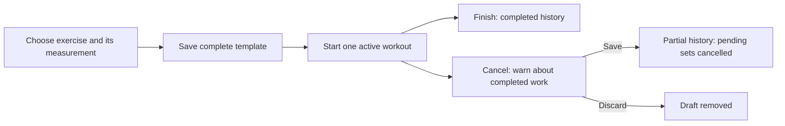

# Proposed workout API contracts after the owner's follow-up decisions

Status: **design proposal, not implemented**. The owner approved timed
Bodyweight exercises, complete templates before Save, and the Cancel choice
described here. The paths, JSON field names, and error codes below are proposed
technical contracts for review. They do not make the remaining questions in
[database design](../database/design.md#remaining-future-decisions-and-review-boundary)
approved rules. No product FastAPI endpoints exist yet.

Read the [initial API foundation](foundation.md) for the proposed common error
envelope and the [database design](../database/design.md) for the current
schema, future migration, history protection, and one-active-workout rule.
Every private route below needs verified Google/Microsoft sign-in and owner
checks. A caller-supplied user ID is never proof of identity. All examples use
synthetic IDs. The backend never exposes ExerciseDB credentials.

## How the actions fit together



| User action | Proposed endpoint | Input | Result |
|---|---|---|---|
| Create a custom exercise | `POST /api/v1/exercises` | Name, category ID, body-part ID, `measurement_kind` | `201` with exercise ID and effective kind |
| Save a new template | `POST /api/v1/workout-templates` | Name, ordered exercise IDs and sets with complete targets | `201` with template ID/version |
| Save changes to a template | `PUT /api/v1/workout-templates/{template_id}` | Same complete plan plus expected version | `200` with next version; conflict if stale |
| Start from a saved template | `POST /api/v1/workout-sessions` | `template_id` | `201` with in-progress session ID and starting snapshot |
| Cancel and choose Save or Discard | `POST /api/v1/workout-sessions/{session_id}/cancel` | `action` and explicit discard confirmation | Saved partial session or discarded draft |

These are the affected actions, not a complete exercise, template, set, or
history API. Adding a set, completing a set, normal Finish, and optional source
template update need their own contract review. Read-only catalog search must
eventually combine stored and vendor data as separately designed.

### Timed Bodyweight exercise

Example request to create a custom Plank (the category ID is the existing
Bodyweight seed; other IDs are illustrative):

```json
{
  "name": "Plank",
  "category_id": 4,
  "body_part_id": 6,
  "measurement_kind": "duration"
}
```

Example successful response: `201`

```json
{
  "id": "11111111-1111-4111-8111-111111111111",
  "name": "Plank",
  "category_id": 4,
  "body_part_id": 6,
  "measurement_kind": "duration"
}
```

For a new Bodyweight exercise, the UI must let the person choose reps or
duration. The other existing categories keep their seeded kind. `422` rejects
an unsupported kind/category pair, blank name, unknown category/body part, or
unselected body part. The `None` body part is a real selected record. Provider
exercises need a backend mapping to an effective kind; no vendor payload is
trusted to choose it silently. Changing an existing exercise kind when a live
template uses it needs a compatibility check and further edit design.

### Save a complete template

Example request for one timed set. `target_duration_seconds` is positive;
reps and distance are absent because the Plank's effective kind is duration.
Weight is optional, so these examples omit it. A supplied weight needs a unit.

```json
{
  "name": "Core practice",
  "exercises": [
    {
      "exercise_id": "11111111-1111-4111-8111-111111111111",
      "position": 1,
      "sets": [
        {"set_number": 1, "target_duration_seconds": 45, "rest_seconds": 120}
      ]
    }
  ]
}
```

Example `201` response:

```json
{"id": "22222222-2222-4222-8222-222222222222", "version": 1, "exercise_count": 1}
```

This route creates or edits the signed-in person's own template. Creating a
shared sample is separate administration work. The service checks the complete
submitted plan in one transaction before publishing it. It rejects no
exercises, inaccessible exercise IDs, missing required exercise details,
missing or nonpositive targets, duplicate positions
or set numbers, incompatible reps/duration/distance fields, and incomplete
weight/unit pairs. For Cardio, each set needs positive duration and distance;
for duration kind, positive duration; for reps kind, positive reps. It does not
insert a partly valid template. An edit also checks its expected version and
preserves history. `422 incomplete_template` identifies missing fields;
`403 forbidden` or `404 not_found` protects private exercise ownership;
`409 version_conflict` handles a concurrent edit. The exact rule for a
zero-set exercise remains open, so this contract cannot yet be marked ready.

### Start and cancel an active workout

Example start request:

```json
{"template_id": "22222222-2222-4222-8222-222222222222"}
```

Example `201` response:

```json
{"id": "33333333-3333-4333-8333-333333333333", "status": "in_progress"}
```

Start validates a complete saved template, captures its exercise kind and
targets once, and reserves the single active slot. `409 active_workout_exists`
means another workout is already in progress; `422 incomplete_template`
means a legacy or changed plan cannot start. Start must not create a personal
copy of a sample. Ad hoc start needs a separate request shape.

On Cancel, the UI explains: **Discard will delete this active workout,
including sets you already completed. Save keeps completed sets and marks
unfinished exercises cancelled.** The server still requires an explicit
confirmation for Discard; a mistaken click or request without confirmation
cannot delete anything.

Save request:

```json
{"action": "save"}
```

Example `200` response:

```json
{
  "id": "33333333-3333-4333-8333-333333333333",
  "status": "cancelled",
  "completed_sets": 1,
  "cancelled_sets": 1,
  "finished_at": "2026-11-02T12:00:00Z"
}
```

Save changes every pending set to `cancelled` and the parent to `cancelled`
atomically. Completed sets and their event times are kept. Already skipped
sets remain skipped. An exercise with any cancelled set is presented as a
cancelled exercise; its completed sets remain visible. The result is retained
history and cannot be discarded later.

Discard request:

```json
{"action": "discard", "confirm_discard_completed_work": true}
```

Example result: `204 No Content`. The operation locks the verified user's
in-progress session, removes its children and session in one transaction, and
frees the active slot. `422 confirmation_required` rejects a missing/false
confirmation; `403/404` protects another user's session; `409
workout_already_finished` rejects a terminal session. A retry after successful
Discard must never delete another workout; the precise retry response and
request-id scheme remain to be finalized. Do not expose completed set values
in error responses or telemetry.

## Validation examples for implementation

| Case | Expected result |
|---|---|
| Duration Bodyweight set with 45 seconds, no reps and no weight | Accepted after new migration; session snapshot records duration kind |
| Duration Bodyweight set with reps, missing duration, or zero duration | Rejected without partial writes |
| Save template with no exercises or missing required targets | Rejected; no published partial template |
| Two simultaneous start requests for one user | At most one active session; the other gets a safe conflict |
| Cancel, Save after one completed and one pending set | One retained partial session; completed set unchanged; pending set cancelled |
| Cancel, Discard after completed sets, without confirmation | Rejected; all draft rows remain |
| Cancel, Discard with confirmation | Only that user's active draft is removed atomically, including completed draft work |
| Discard another user's or a terminal session | Rejected; saved history remains intact |
| Migration with existing exercises and sessions | Existing exercise kinds backfilled; historical snapshots and seeds unchanged |

Test the schema and service paths on a disposable PostgreSQL 17 database.
Do not apply the new migration to a participant's existing or shared database
without the separate target review and authorization described in the setup
guide. No real vendor or model requests are needed for these checks.

## Questions still needing a decision

1. Must every template exercise contain at least one set? This is the
   recommended interpretation of “all necessary targets before Save.”
2. Should Cancel then Save be offered when no sets were completed, or should
   that case offer Discard only? The schema can represent either.
3. Should a saved partial workout offer the same optional source-template
   update as a normally finished workout? The existing update choice applies
   at normal Finish; it is not silently extended here.
4. Should completed sets in a saved partial workout count as “last
   performance” for future suggestions?
5. May an exercise's measurement kind be changed after it has been used in a
   live template? Which extra categories, if any, need a duration choice?
6. Which retry result should a repeated Discard request return? This is an
   engineering contract detail to settle with the implementation story.

After these choices and approval of the proposed paths/payloads, Product Owner
can split implementation into small stories. This document grants no API or
migration implementation work by itself.
