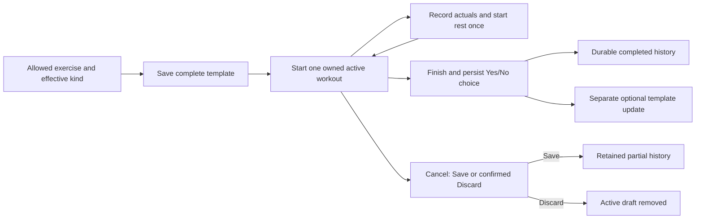

# Workout API design for review

**Status: proposed technical contracts; not implemented.** The owner's product
rules below remain approved. Paths, JSON names, safe error codes, response
bounds and recommendations are proposals for review, not implementation
authorization. PR #34 merged this design into main at `5a10833`, but current
application behavior still has only the liveness API and database revisions
`0001_database_foundation`/`0002_master_records`. Closed PR #33 did not deliver
an accepted #30 migration.

Decision provenance matters here: the owner-authored
[PR #33 description](https://github.com/dhaval-mistry/unshaken-smart-coach/pull/33)
records the later approval that every saved template exercise has at least one
valid set on creation and update. PR #33 was closed without merge, so none of
its implementation or test claims are accepted baseline behavior. Open issues
#23, #24, #25 and #30 now record the approved minimum-set rule; D1–D9 remain
explicit owner gates where applicable.

Use [shared HTTP/access/deadline rules](foundation.md), the
[exercise contracts](exercises.md) and [database design](../database/design.md).
All examples use synthetic UUIDs. Every route below requires verified
Google/Microsoft identity and owner checks; no request user ID grants access.

## Approved workflow

A saved template has at least one exercise and **at least one valid set per
included exercise**, on creation and updates. Required targets depend on
effective kind: reps, duration, or duration plus distance. Weight is optional;
a supplied weight requires kg/lb and zero remains distinct from missing.
New sets use the approved 120-second rest default.

Starting captures a complete immutable plan, using an allowed personal or sample
source. At most one workout per user may be active. Completing a pending set
records actuals and starts rest once. Targets are never assumed actuals.

At normal Finish ask once whether to update the source. No leaves it unchanged;
Yes updates the user's personal source or creates a personal copy of a sample.
Completed history survives optional-update failure. Exact mapping is D3 below.

Cancel offers confirmed Discard (including completed draft work) or Save
(retain completed work and cancel pending sets). Retained terminal history
cannot later be discarded or rewritten. Template updates after partial Save
are not implicitly approved.



## Proposed route map

| Issue/action | Method and path | Success |
|---|---|---|
| #23 create template | `POST /api/v1/workout-templates` | `201` identity/version |
| #23 replace personal plan | `PUT /api/v1/workout-templates/{template_id}` | `200` next version |
| #24 start from template | `POST /api/v1/workout-sessions` | `201` active session identity |
| #25 complete pending set | `POST /api/v1/workout-sessions/{session_id}/sets/{set_id}/complete` | `200` stored actuals/events |
| #26 Finish and choose | `POST /api/v1/workout-sessions/{session_id}/finish` | `200` durable completion/update outcome |
| #27 cancel | `POST /api/v1/workout-sessions/{session_id}/cancel` | `200` partial history or JSON discard acknowledgement |
| #28 list retained history | `GET /api/v1/workout-history` | `200` own retained session summaries |
| #28 inspect retained workout | `GET /api/v1/workout-history/{session_id}` | `200` captured plan/actual history |
| #29 prior exercise performance | `GET /api/v1/exercises/{original_exercise_id}/performances` | `200` own original-identity occurrences, subject to D6 |

Use a JSON discard acknowledgement rather than a bodyless `204` to preserve the
shared application JSON-response contract. This changes the earlier proposed
transport response, not the approved Discard outcome; review it under D5.
The server-generated request ID is correlation metadata, not a mutation
idempotency key. Unknown fields/methods use the shared envelope.

## Save a complete template

#23 proposed timed-set request:

```json
{
  "name": "Core practice",
  "exercises": [
    {
      "exercise_id": "11111111-1111-4111-8111-111111111111",
      "position": 1,
      "sets": [{"set_number": 1, "target_duration_seconds": 45}]
    }
  ]
}
```

Proposed `201` response:

```json
{"id":"22222222-2222-4222-8222-222222222222","version":1,"exercise_count":1}
```

Create/edit only the caller's personal template. Shared-sample administration
is excluded. Validate the entire candidate before publishing: name, at least one
exercise, at least one valid set each, accessible exercise definitions,
explicit unique positive exercise positions/set numbers, kind-compatible
positive targets, and optional weight/unit pairs. Preserve repeated exercises
as distinct ordered entries; do not de-duplicate by name or catalog ID.

The proposed edit uses the same full candidate plus `expected_version`.
Lock/check ownership and version inside the write transaction, then replace
children and advance version once. A stale candidate returns
`409 version_conflict` without overwriting the current plan. Temporary missing
children within one transaction are permitted, but its final committed state
must be complete; a deferred database guard protects direct writers too.
Any failure restores the full previous plan/version. Do not silently save a
partially valid subset.

Proposed incomplete client edits remain unsaved client state, not implemented
stored drafts. A future server-draft feature would need an explicitly reviewed
draft/published model. No such state/table is approved here.

Kind rules: reps requires `target_reps > 0`; duration requires positive
`target_duration_seconds`; Cardio requires positive duration and
`target_distance_meters`. Unused fields are absent/NULL, not dummy values.
If `suggested_weight` is supplied, require `weight_unit`; a unit alone is
invalid. Decimal values use exact decimal serialization, not float arithmetic.
Existing rest fields/defaults do not authorize new timer controls.

Use `422 incomplete_template` for missing required plan/target data and
`422 invalid_request` for malformed/incompatible values. Return the same safe
`404 not_found` for inaccessible and unknown private exercise/template IDs.
Template edits never change snapshots or actuals of existing sessions.
#30 owns new completeness/effective-kind guards; #23 does not duplicate them.

## Start a workout

#24 request:

```json
{"template_id":"22222222-2222-4222-8222-222222222222"}
```

Proposed `201` response:

```json
{"id":"33333333-3333-4333-8333-333333333333","status":"in_progress"}
```

In one transaction, derive the caller from verified identity, lock/read an
authorized complete template/version, validate ownership of all custom entries,
create the parent and ordered children, capture source identities/kinds/targets,
and seal the immutable starting-plan JSON. Snapshot and relational initial rows
must match before commit. Include actual effective exercise kind, not mutable
category labels; later catalog changes cannot reinterpret the capture.

Start from a shared sample uses that sample directly; no personal copy is made
at Start. Unknown/private template IDs use identical `404`; incomplete plans
return `422 incomplete_template`. The database's unique active-session index
arbitrates concurrent starts: one succeeds, the other returns
`409 active_workout_exists`, without partial children. Other users proceed
independently. The response must not reveal the other workout's details.

No generic auto-retry of Start after an uncertain commit: a future explicit
idempotency/reconciliation contract is required before promising identical
replay results. Ad hoc start, mid-workout additions/reordering/removal and
save-as-template are excluded from #24.

## Complete a set once

#25 proposed reps request:

```json
{"actual_reps":10,"actual_weight":"0.000","weight_unit":"kg"}
```

Use positive actual reps for reps kind, duration for duration kind, and both
duration/distance for Cardio. Validate against the captured immutable kind.
Weight is optional; actual zero with unit is not the same as missing.
Do not copy any target into an omitted actual field or silently convert units.

Inside one transaction verify that the addressed set belongs to the addressed
session and that the verified user owns that active session. Lock consistently
with Finish/Cancel/Discard, then transition pending → completed exactly once,
recording actuals, `completed_at` and `rest_started_at` using one server event
time. Capture/use the set's existing rest interval; no timer reset or new
user-wide default is added.

Proposed response returns stored set ID/status, actual measurement fields
(including explicit NULL for absent optional values), event timestamps and rest
seconds. A same-result duplicate can return the stored result without writing;
a conflicting resubmission returns `409 set_already_completed`, also without
rewriting actuals or restarting rest. This duplicate-response choice is proposed;
the approved invariant is first committed performance/event preservation.
Unknown/foreign IDs return safe `404`; inactive/terminal sessions return
`409 workout_already_finished` after ownership is established.

No correction/undo, skip, pause, rest alarm or set-reordering behavior is
introduced. The existing completion primitive is a starting point, not an API
authentication implementation.

## Finish and optional template update

#26 proposed request:

```json
{"update_template":false}
```

The explicit Boolean is required for a template-backed session; absence is not
an implicit No. Verify ownership and active status, serialize with set
completion/cancellation, then commit terminal status, server finish time,
recorded choice and completed history **before** attempting any optional
template write. Preserve starting plan, source identity/version and actuals.

No leaves source data and version unchanged. Yes on a personal source targets
that same owned personal template. Yes on a sample creates one personal copy,
never modifies the shared sample. A deleted/stale/inaccessible source produces
a safe update conflict, not a recreated source or loss of workout history.

Proposed response exposes `status: "completed"` and the recorded
`template_update` outcome (`declined`, `pending`, `applied` or `conflict`),
not an error claiming the workout failed when only its optional update failed.
The optional transaction validates captured source version/ownership and the
complete resulting plan before any template change. Return the already recorded
result for a repeated Finish; never create duplicate history or a second sample
copy, change the saved answer, or reinterpret late actuals.

**Implementation gate D3:** the owner's Yes/No description does not decide
whether template targets copy actual performed values or separately edited
planned values. Example: start 3×10, perform 12/10/8. Does Yes save 12/10/8 or
the edited planned targets? Removed/skipped/added rows, blank weight handling,
unit changes, duplicate-copy prevention and retry/expiry rules must be explicit.
Recommendation for review: use an explicit complete proposed template candidate,
show it before confirmation, preserve optional missing weights without inventing
values, and reject stale sources rather than silently overwriting them. This is
a proposal, not an approved field mapping or new endpoint.

D9 also asks how normal Finish handles remaining pending sets. Recommendation:
reject with `409 unfinished_sets` until they are completed or handled by a
separately approved action; do not silently treat them as completed/cancelled.
Do not implement an affected Finish/update branch before these decisions.

## Cancel with Save or Discard

#27 must communicate: **Discard deletes this active workout, including sets
already completed. Save keeps completed work and cancels pending sets.**
The backend requires explicit confirmation, not just a UI warning.

Save request:

```json
{"action":"save"}
```

Proposed `200` result:

```json
{
  "id":"33333333-3333-4333-8333-333333333333",
  "status":"cancelled",
  "completed_sets":1,
  "cancelled_sets":1,
  "finished_at":"2026-11-10T12:00:00Z"
}
```

In one transaction lock the verified owner's active parent using the shared
operation lock order, retain its initial JSON/completed actuals/event times,
change pending sets to `cancelled` with no actual/unit/completion/rest fields,
retain skipped sets, and set parent `cancelled` plus server terminal time.
Dirty pending performance is a conflict, not permission to erase it.
Derive a cancelled-exercise display from its sets; do not add competing status.

Discard request:

```json
{"action":"discard","confirm_discard_completed_work":true}
```

Proposed `200` acknowledgement:

```json
{"id":"33333333-3333-4333-8333-333333333333","status":"discarded"}
```

This acknowledgement is not a retained workout record or a promised retry
tombstone. The narrow operation rechecks verified ownership/active status and
confirmation while locked, then deletes sets, exercises and parent atomically.
It releases the active slot, never deletes terminal/saved-partial history, and
a later transaction failure restores all draft rows.

Follow the [database privileged-discard proposal](../database/design.md#privileged-discard-boundary-proposal).
A supplied owner UUID or caller-set flag does not prove permission. Keep the
privileged function unavailable to PUBLIC/ordinary writers; grant only to the
approved trusted backend invoker. API auth derives the owner independently.

`422 confirmation_required` rejects missing/false confirmation, `404` hides
unknown/foreign sessions, and `409 workout_already_finished` rejects an owned
terminal session. Repeated Save cannot reopen or change retained values.
D5 proposes a safe `404` after successful Discard when the row is absent,
rather than adding a new tombstone table; approve the replay contract first.
D4 still decides whether Save is offered/accepted with zero completed sets.
The schema can represent that case without deciding the product/UI behavior.
No template update is implicitly offered by partial Save.

## Read saved history

#28 reads only the verified user's retained completed/cancelled sessions.
Do not include in-progress drafts or discarded drafts. A foreign/unknown session
has the same safe `404`. Source catalog/template disappearance never makes
an owned retained session disappear.

Proposed summary fields: session ID, captured name, terminal status, start/finish
times and captured source kind/original ID. Detail additionally returns the
starting-plan snapshot and ordered captured exercises/sets with their captured
kind, starting targets, recorded actuals/units and event times. Distinguish the
initial plan from later execution additions/removals; NULL live source links
do not erase original identity. In partial history completed work remains visible,
pending sets are cancelled, and skipped sets stay skipped.

Never recalculate historical fields from current names, template targets or
provider data. Preserve decimal values and kg/lb exactly; no inferred actuals,
unit conversion or mutable previous-weight copy. Reads do not touch timestamps,
repair data, or trigger template updates.

List ordering/result-size/pagination is not settled by #28. A proposed contract
for review is explicit bounded page size (1–100) with an opaque cursor over
(finished_at, id), ordered newest first. This is a technical proposal, not an
approved pagination default or additional filtering scope. Agree it before
implementing an unbounded history query or silently truncating results.

## Read previous performance

#29 uses `original_exercise_id` to search the user's retained snapshots across
**all** templates/workouts, including sources since deleted. Matching only a
current live FK, exercise name or current template is incorrect. Similarly
named exercises with different original IDs remain distinct.

Proposed result occurrences contain original exercise/session identity, captured
effective kind, terminal session status, set identity/order, actual measurements,
optional recorded weight/unit and event times. A missing performance can return
`200 {"items":[]}` without revealing another user's records. Do not require a
current catalog row to exist merely to read owned retained history.

**Gate D6:** repeated-exercise/set grouping, result count/order/latest definition
and completed sets from partial sessions remain open. Recommended first contract
for review: bounded raw occurrences with explicit captured IDs/status/times;
do not label one result a matched suggestion until its rule is approved.
No cross-user comparison, actual/target comparison, unit conversion or AI
recommendation is introduced. The API is read-only and needs no additional
performance-cache table.

## Transaction, error and validation obligations

Use one backend database access boundary and consistent operation locking.
Acquire the coarse foundation operation lock before parent/child row locks
within trusted operations; bound pool, lock and statement waits and preserve
rollback on cancellation. Direct SQL writers must still satisfy commit-time
guards; migration maintenance must quiesce writes to avoid conflicting lock
orders. Do not use the global foundation lock as a throughput claim.

Own the transaction at the service boundary. Validate/authorize under the same
transaction as mutation, emit response only after a known commit, rollback and
release in all exit paths. Treat a lost commit acknowledgement as uncertain;
do not replay non-idempotent Start/Save/optional-copy operations automatically.
Finish history and its optional template write are intentionally separate commits.

All routes reuse safe JSON errors/UUID/no-store. Common private errors include
`401 authentication_required`, indistinguishable unknown/foreign `404 not_found`,
`422 invalid_request`, route-specific safe `409` conflicts, expected dependency
`503 database_unavailable`, and unexpected `500 internal_error`.
Never return SQL, raw exception text, submitted values or another user's state.
No endpoint trusts a user ID from the request or exposes health/performance in logs.

For every story verify authorized/foreign/unknown IDs, forged user IDs, valid and
invalid measurements, no partial writes, rollback, concurrency, retry behavior,
history/source detachment, safe logs and matching OpenAPI/examples. On disposable
PostgreSQL, #30 additionally needs fresh and representative-data upgrades,
preflight conflicts, exact seed/timestamp/snapshot preservation and compatible/
incompatible rollback. Distinguish mocks from actual database/provider/store
delivery. These checks are requirements, not tests run by this design revision.

## Owner decisions and approval checklist

Approved minimum-one-set, measurement/weight rules, one-active/history rules and
high-level Finish/Cancel choices are retained; do not ask for them again.
The following decisions are **not approved** merely by appearing as recommendations.

| ID / affected work | Required decision | Recommendation for review / alternative |
|---|---|---|
| D1 / #30 discard | Approve the privileged execution boundary | Restrict to migration owner until an explicitly granted trusted backend role exists; revoke PUBLIC in the same transaction. Alternative implementation must provide equivalent narrow capability and no caller-flag bypass. |
| D2 / #30, future catalog edit | Kind change while a live template references the exercise? | Temporarily prohibit it and require remove/replace references. Alternative: authorized atomic conversion of all live targets in a separately designed edit flow. Historical kinds never change. |
| D3 / #26 | Actual performance versus edited planned targets on Yes; skipped/removed/added sets, optional weights/units and retry/expiry | Review a complete explicit proposed candidate before updating; reject stale source, do not invent missing weights, and retain completed history. Owner selects the actual field mapping. |
| D4 / #27, future partial update | Accept Save with no completed sets? Offer template update after partial Save? | Offer Discard only for zero-completion cases; keep partial-template update out of the first scope. Alternatives require explicit owner choice. The schema may represent zero-completion partial history. |
| D5 / #27 | JSON acknowledgement and repeat Discard response | JSON 200 acknowledgement; later absent row uses safe 404, no tombstone schema. Alternative durable idempotent replay requires reviewed storage/expiry. |
| D6 / #28/#29 | History response bounds; repeated-exercise/set grouping, latest-result rule and partial inclusion | Review explicit bounded history pages and raw prior occurrences before adding matched suggestions; owner decides partial inclusion and matching semantics. |
| D7 / #21 | Provider terms/mapping/retention, no-persistence selection and search bounds/ranking | Verify official rights first; block only affected persistence/selection when unsettled. No fabricated vendor limits or cache table. |
| D8 / all private APIs | Approved Google/Microsoft identity/session/account-linking contract and story | Establish a separate auth prerequisite; no automatic email linking or caller-ID fallback. Choose bearer/session storage before private implementation. |
| D9 / #26 | Normal Finish with pending sets | Reject unfinished sets; explicit completion/cancellation or a separately approved skip action is required. Alternative must preserve truthful history. |

Owner review can approve independent sections while leaving gated behaviors
unapproved. A separately requested Developer follows only the approved slice;
Code Reviewer/Tester roles and migrations are not invoked automatically.
