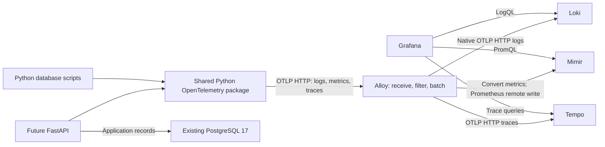

# Local observability design

Design status: **Alloy/Mimir revision PROPOSED FOR REVIEW**, requested on
2026-11-01. Requesting this revision does not approve it for implementation.
The earlier approval is retained below.

Implementation status: **Not started**. Root Compose defines PostgreSQL 17
only. No observability configuration, shared telemetry package, or backend
application exists yet. This document does not create them.

Related work: [#7](https://github.com/dhaval-mistry/unshaken-smart-coach/issues/7)
through [#11](https://github.com/dhaval-mistry/unshaken-smart-coach/issues/11),
plus API stories [#12](https://github.com/dhaval-mistry/unshaken-smart-coach/issues/12)
through [#15](https://github.com/dhaval-mistry/unshaken-smart-coach/issues/15).
All nine issues were read; all were open with no comments at review time.
They still describe the earlier plan and were not changed by this review.

## Approval record and proposed changes

The owner previously approved the local optional Compose approach, shared Python
OpenTelemetry package, standalone Collector, Prometheus scraping its application
metrics endpoint, Loki native OTLP ingestion, Tempo, Grafana, internal stores,
and retention of three days for logs/metrics and 24 hours for traces.

| Area | Previously approved | Proposed revision |
|---|---|---|
| Application instrumentation | Shared OpenTelemetry SDKs and OTLP | Keep |
| Collection service | Standalone OpenTelemetry Collector | Alloy with OpenTelemetry components |
| Metrics path | Collector exposes metrics; Prometheus scrapes and stores | Alloy converts OTLP metrics and remote-writes to Mimir |
| Metrics queries | Grafana queries Prometheus | Grafana uses its Prometheus data-source type to query Mimir |
| Logs and traces | Loki native OTLP HTTP; Tempo OTLP | Keep; Alloy forwards the signals |
| Local deployment | Optional services in root Compose; PostgreSQL independent | Keep |
| Retention and privacy | Three days logs/metrics; 24 hours traces; no sensitive data | Keep |
| Container logs | No second copy of application logs | Defer Docker-daemon collection; optional later scope |

This revision is not a production architecture. Cloud hosting, alerts, high
availability, frontend telemetry, and PostgreSQL-server monitoring stay outside
the initial scope. No database product question is resolved here.

## Components and signal flow

OpenTelemetry is still how application code creates and exports telemetry.
Alloy is the collection process; replacing a separate Collector container does
not remove OpenTelemetry. Grafana describes Alloy as its OpenTelemetry Collector
distribution with Prometheus capabilities.
[Official Alloy overview](https://grafana.com/oss/alloy-opentelemetry-collector/).

| Component | Responsibility |
|---|---|
| Shared Python OpenTelemetry package | Create logs, metrics and traces; export OTLP |
| Alloy | Receive, filter, batch and forward signals |
| Mimir | Store metrics and answer PromQL queries |
| Loki | Store and search structured logs |
| Tempo | Store and retrieve traces |
| Grafana | Query the stores and show dashboards |
| PostgreSQL | Application records; separate from telemetry |

The proposed optional profile has five services: Alloy, Mimir, Loki, Tempo and
Grafana. PostgreSQL remains the existing sixth service in the root project.

### Receive and process

Use Alloy's stable component configuration, with `otelcol.receiver.otlp`,
memory limiting, safe-field filtering, batching, and separate signal exporters.
Do not require a preview engine or a separate upstream Collector process.
Configure listeners explicitly, including OTLP HTTP on container port 4318.
Keep OTLP gRPC 4317 internal and enable it only for a demonstrated client.

Applications send OTLP HTTP/protobuf to Alloy. Distinguish a base endpoint from
per-signal URLs: SDKs may append `/v1/logs`, `/v1/metrics`, and `/v1/traces`.
Record the chosen SDK settings and avoid appending a path twice.
[Alloy OTLP HTTP exporter reference](https://grafana.com/docs/alloy/latest/reference/components/otelcol/otelcol.exporter.otlphttp/).

### Logs to Loki

Forward application logs with Alloy's `otelcol.exporter.otlphttp` to the base
`http://loki:3100/otlp`; the final log path is `/otlp/v1/logs`.
Use a Loki version/schema that supports structured metadata and enable it.
Store trace IDs as structured fields, not index labels. Preserve the earlier
native OTLP choice; do not switch these application logs to a legacy Loki
exporter merely because an older example uses one.
[Loki native OTLP documentation](https://grafana.com/docs/loki/latest/send-data/otel/).

### Metrics to Mimir

Choose one application-metric path:
`otelcol.receiver.otlp -> processors -> otelcol.exporter.prometheus ->
prometheus.remote_write -> Mimir`.

Here `otelcol.exporter.prometheus` converts OTLP metric data for Alloy's
Prometheus pipeline; it is not a standalone Prometheus server. Do not keep the
old Collector scrape endpoint on 8889 or add a second scrape of the same app
metrics. Alloy can later scrape approved infrastructure targets with its own
Prometheus components, but that is separate scope.
[Alloy's supported OTLP-to-remote-write flow](https://grafana.com/docs/alloy/latest/collect/opentelemetry-to-lgtm-stack/).

Remote-write destination: `http://mimir:9009/api/v1/push`.
Persist Alloy's remote-write write-ahead log (WAL: a local buffer on disk).
Bound its retention, queues, and disk growth. Do not promise that every metric
survives an unlimited outage.
[Alloy remote-write component](https://grafana.com/docs/alloy/latest/reference/components/prometheus/prometheus.remote_write/).

Grafana uses data-source type **Prometheus**, named Mimir, with base
`http://mimir:9009/prometheus`. Keep a stable data-source UID for dashboards.
Test metric-name/attribute conversion, units, counters, histogram buckets, and
trace exemplars if enabled. Update example queries to actual exported names.
Mimir also offers OTLP ingestion, but do not enable that as a second route.
[Mimir write/query API](https://grafana.com/docs/mimir/latest/references/http-api/).

### Traces to Tempo

Use a separate Alloy OTLP HTTP exporter with base `http://tempo:4318`,
giving final path `/v1/traces`. Grafana queries `http://tempo:3200`;
the query port is not the ingestion port. Configure Tempo's receiver explicitly
on its container interface. Preserve trace/span IDs across logs and traces.
[Tempo configuration](https://grafana.com/docs/tempo/latest/configuration/).

## Local Mimir storage and deployment choice

**Recommendation for approval:** one Mimir process in monolithic mode
(`target=all`), classic ingestion explicitly selected, replication factor one,
and local filesystem block storage in a dedicated named volume. This is a
development-only choice with no high availability or shared storage.

Monolithic mode is documented for development. Classic ingestion is still
documented, while Mimir 3.0's preferred ingest-storage architecture requires
Kafka or a compatible broker. Deployment mode and ingestion architecture are
different choices: running one process does not automatically remove Kafka.
[Mimir deployment modes](https://grafana.com/docs/mimir/latest/references/architecture/deployment-modes/),
[classic architecture](https://grafana.com/docs/mimir/latest/get-started/about-grafana-mimir-architecture/about-classic-architecture/),
[ingest-storage architecture](https://grafana.com/docs/mimir/latest/get-started/about-grafana-mimir-architecture/about-ingest-storage-architecture/).

The configuration reference includes filesystem block storage and an
`ingest_storage.enabled` switch. Combining these supported pieces is our
local design recommendation, not a configuration we have run. Select a fixed
supported image and verify the combination before calling setup runnable.
Keep block storage, WAL/TSDB data, compactor working files, and any enabled
rule/Alertmanager storage in distinct directories; never let block cleanup
operate on rule/alert state.
[Mimir configuration reference](https://grafana.com/docs/mimir/latest/configure/configuration-parameters/).

No Kafka, MinIO, external bucket, or cloud credentials are proposed for this
single-node filesystem variant. An S3-compatible deployment would need a
separate object-storage service such as MinIO and bucket initialization;
ingest-storage mode would additionally need a broker. These add containers,
credentials, disk use, and verification work. Do not introduce them silently
if the selected version cannot support the local variant; bring that material
change back for approval.
[Mimir object-storage options](https://grafana.com/docs/mimir/latest/configure/configure-object-storage-backend/).

Propose local single-tenant mode for Mimir, Loki, and Tempo, with no host ports
for these stores. Tenant IDs are not authentication. If shared/multi-tenant or
remote use is needed, design an authenticated boundary separately.

## Application logs versus container logs

**Default proposal:** application OpenTelemetry logs only. Keep console logs
as a troubleshooting fallback, but do not ingest the same console output from
Docker as well. The baseline needs no Docker socket or host log mount.

Example: one API failure is exported through OpenTelemetry to Alloy and Loki.
Collecting its console copy from Docker too would produce two stored entries.

**Optional later scope:** Alloy can discover containers and read their stdout/
stderr through `loki.source.docker`, then process/allowlist fields and send
them through `loki.write` to Loki's `/loki/api/v1/push`. That path is distinct
from native application OTLP logs. Allowlist only approved infrastructure
containers; exclude SDK-exported application streams, unrelated projects, and
the collector's own logs by default to avoid loops.
[Alloy Docker log source](https://grafana.com/docs/alloy/latest/reference/components/loki/loki.source.docker/).

Docker discovery/log reading needs daemon API permission. On Linux this often
means access to `/var/run/docker.sock`; on Docker Desktop the supported access
must be verified for the actual platform. A read-only socket bind is not a
read-only Docker API. Daemon access can confer host-level control.
[Docker permission guidance](https://docs.docker.com/engine/install/linux-postinstall/).

Do not add a privileged container, socket mount, or broad host mounts to the
baseline. If container logs are requested, approve the target list and daemon
access approach first; evaluate a restricted API proxy and persist read
positions under Alloy's data directory. Test restart behavior and duplicates.
Do not collect PostgreSQL logs automatically; they may contain sensitive SQL.

## Runtime placement, ports, and private settings

Extend root `compose.yaml` with an optional `observability` profile. Use
service names `alloy`, `mimir`, `loki`, `tempo`, and `grafana`.
Keep PostgreSQL's service, volume, and lifecycle independent. A host backend
uses published loopback ports; containers use service names on the trusted
Compose network. Bind receivers on container interfaces, but publish only the
host ports needed locally.

| Connection | Proposed address | Host publishing |
|---|---|---|
| Browser to Grafana | `http://127.0.0.1:3000` | Loopback 3000 |
| Host Python process to Alloy | `http://127.0.0.1:4318` | Loopback 4318 |
| Container Python process to Alloy | `http://alloy:4318` | None beyond the above |
| Alloy diagnostics | `http://alloy:12345` | Internal only |
| Alloy to Mimir | `http://mimir:9009/api/v1/push` | Internal only |
| Alloy to Loki | `http://loki:3100/otlp` | Internal only |
| Alloy to Tempo | `http://tempo:4318` | Internal only |
| Grafana to Mimir | `http://mimir:9009/prometheus` | Internal only |
| Grafana to Loki / Tempo | `http://loki:3100` / `http://tempo:3200` | Internal only |

Local internal HTTP is proposed for this trusted development network only.
Do not expose unauthenticated ingestion, stores, Alloy administration, or debug
endpoints to public interfaces. Revisit TLS/authentication for remote use.
[Alloy receiver access guidance](https://grafana.com/docs/alloy/latest/access_permissions/).

Use private root `.env` values and placeholder-only `.env.example`.
Protect Grafana with private credentials and disable anonymous access.
Do not print rendered Compose/configuration output containing secrets. Select
pinned compatible images/digests; avoid `latest`. Exact versions, permissions,
port overrides, and measured resource limits belong in the implementation PR.

## Proposed file ownership

| Path | Responsibility |
|---|---|
| `docs/architecture/observability.md` | This maintained design and approval record |
| `docs/setup/observability.md` | Planned setup, later replaced by verified commands |
| `compose.yaml` | Optional service wiring; existing PostgreSQL preserved |
| `observability/alloy/config.alloy` | Receivers, processors, signal routing |
| `observability/mimir/mimir.yaml` | Local metrics storage, ingestion, retention |
| `observability/loki/loki.yaml` | Native OTLP logs and retention |
| `observability/tempo/tempo.yaml` | Trace ingestion, local storage, retention |
| `observability/grafana/provisioning/` | Data sources and log-to-trace links |
| `observability/grafana/dashboards/` | Reviewed dashboards |
| `backend/app/telemetry/` | Shared Python SDK setup and helpers |

Paths are proposed, not files created by this task. Do not build the earlier
`observability/otel/` and `observability/prometheus/` configuration in parallel.
Do not remove any existing implementation or data without inspecting it first.

## Shared Python package

Keep the agreed package responsibilities:
`__init__.py` exposes helpers; `setup.py` initializes exporters and performs
bounded shutdown; `logging.py` supplies safe structured logs; `metrics.py`
records counters/durations; `tracing.py` provides standard/custom spans.
Tests belong in `backend/tests/telemetry/`.

FastAPI and backend scripts still use the same package and one uv project.
Business code does not configure Alloy, Mimir, Loki, or Tempo clients. Each
process initializes once; imports do not open connections or start exporters.
Short scripts explicitly flush within a documented deadline.

Caller changes are mainly export settings: a container now targets
`http://alloy:4318` instead of `http://otel-collector:4318`. The host loopback
port can remain 4318. Keep SDK APIs, OTLP, W3C trace context, and safe log fields.
Verify actual SDK log support and metric conversion for the pinned versions.
No shared package exists yet, so this is implementation guidance, not a code
migration already completed. Frontend TypeScript telemetry remains deferred;
SQL migrations never initialize Python telemetry.

## Retention, privacy, resources, and failures

Preserve the approved three-day log/metric and 24-hour trace retention.
Use separate named volumes for Alloy state, Mimir, Loki, Tempo, and Grafana;
never reuse PostgreSQL storage. No old Prometheus volume needs conversion in
the inspected codebase. If runtime data is later discovered, inventory and
preserve it; do not assume deleting a service makes its data disposable.

Mimir needs explicit retention: its compactor removes expired stored blocks.
Configure the three-day policy and verify compactor execution and deletion
delays; retention is not a guarantee of deletion at an exact second.
[Mimir retention](https://grafana.com/docs/mimir/latest/configure/configure-metrics-storage-retention/).
Likewise verify Loki compaction/deletion and Tempo block retention. Keep WALs,
buffers, and working directories within measured disk budgets. Local data is
neither a production backup nor a durable archive.

Allowlist safe telemetry fields in Python first, then filter again in Alloy.
Exclude credentials, tokens, emails, personal/health data, lifting weights,
user notes, prompts, raw bodies, SQL parameters, and sensitive SQL text.
Use bounded metric/index labels such as service, environment, route template,
status, and operation. Keep request/trace/user IDs out of metric/index labels;
safe opaque request/trace IDs may remain structured log fields.

Bound SDK/Alloy memory, batch sizes, retry time, queues, disk buffers, and
shutdown waits. Export must not block or change API/script business results.
Different stores can fail independently; report which signal was dropped.
Do not promise exactly-once delivery or survival across unlimited downtime.

Mimir may use more memory and disk than the earlier single Prometheus server.
Measure idle use, a small synthetic workload, outage backlog growth, restart
recovery, and cleanup before publishing requirements. Document actual CPU,
memory, and disk limits without inventing a minimum laptop specification.
Disable unneeded rule/alert features where supported; alerts remain out of scope.

## Verification required during implementation

No live checks below were performed by this documentation task.

| Layer | Evidence required |
|---|---|
| Configuration and versions | Fixed image/package versions; each config parses using its selected binary; Compose profile/network/volume review without leaking secrets |
| Service readiness | Grafana `/api/health`; Loki `/ready`; Mimir `/ready`; Tempo `/ready`; Alloy `/-/ready` and component health `/-/healthy`, using verified image-compatible probes |
| Signal delivery | Synthetic log with an opaque event ID in Loki; counter/histogram in Mimir via PromQL; trace retrievable in Tempo; Grafana log link opens that trace |
| Metrics correctness | Actual metric names, units, labels, histogram conversion and any exemplars match documented queries; one ingestion path |
| Failure isolation | Stop Alloy, then each store separately on disposable telemetry; operations still return correct results; bounded waits/queues and signal-specific failures recorded |
| Recovery and restart | New signals arrive after recovery; record backlog/drop behavior; store data and Alloy remote-write state survive restart as designed |
| Privacy and duplication | No forbidden fields/high-cardinality labels; one emitted application log is not collected again from Docker; no duplicate handlers/exporters |
| Retention and disk | Shortened-policy tests on disposable telemetry plus documented cleanup delays and measured memory/disk use; never alter the approved normal policy silently |
| PostgreSQL isolation | Stack start/stop/restart does not stop, recreate, migrate, or alter PostgreSQL; application readiness never depends on telemetry |
| Application integration | Later use #10's Python/FastAPI demos and #15's actual lookup requests; distinguish synthetic stack checks, mocks, and real database spans |

Alloy readiness means initial configuration loaded; it does not prove downstream
delivery. Component health is another diagnostic, not a reason to restart a
healthy pipeline continuously during a destination outage.
[Alloy HTTP endpoints](https://grafana.com/docs/alloy/latest/reference/http/).
Mimir and Tempo document readiness separately from their ingestion/query APIs:
[Mimir API](https://grafana.com/docs/mimir/latest/references/http-api/),
[Tempo API](https://grafana.com/docs/tempo/latest/api_docs/).

Do not assume minimal images contain curl or a shell. Select a working probe
method during implementation. Never issue destructive tests against existing
application/shared databases or call real ExerciseDB/model services.

## Story impact and suggested order

Recommendations for a separately requested Product Owner after approval.
No issue was created, edited, closed, or marked Ready by this task.

| Existing story | Recommended change |
|---|---|
| [#7: Publish design](https://github.com/dhaval-mistry/unshaken-smart-coach/issues/7) | Publish this revision with owner approval; retain the earlier decision record and clearly mark replaced collection/metrics choices |
| [#8: Docker stack](https://github.com/dhaval-mistry/unshaken-smart-coach/issues/8) | Replace Collector/Prometheus services with Alloy/Mimir; remove Mimir exclusion; add classic/filesystem mode, Alloy state, data-source paths, and verified readiness/persistence |
| [#9: Shared Python telemetry](https://github.com/dhaval-mistry/unshaken-smart-coach/issues/9) | Keep SDK/helpers; update receiver destination, metric conversion checks, and Alloy outage/privacy criteria |
| [#10: Demos](https://github.com/dhaval-mistry/unshaken-smart-coach/issues/10) | Send both callers to Alloy; query Mimir metrics and retain log/trace correlation; no second demo implementation |
| [#11: Full verification/setup](https://github.com/dhaval-mistry/unshaken-smart-coach/issues/11) | Replace old queries/commands; verify remote-write recovery, compactor retention, actual resource use, and PostgreSQL isolation |
| [#12: FastAPI foundation](https://github.com/dhaval-mistry/unshaken-smart-coach/issues/12) | Refresh design references/export wording; preserve database-independent liveness and existing HTTP contract |
| [#13: Readiness](https://github.com/dhaval-mistry/unshaken-smart-coach/issues/13) | Keep database behavior/deadline; explicitly test Alloy/Mimir failure does not affect readiness |
| [#14: Lookup APIs](https://github.com/dhaval-mistry/unshaken-smart-coach/issues/14) | Replace direct-client exclusions with Alloy/Mimir names; keep endpoint/data rules unchanged |
| [#15: API telemetry](https://github.com/dhaval-mistry/unshaken-smart-coach/issues/15) | Replace scrape flow with Alloy conversion/remote write; show real lookup metrics in Mimir and test Alloy/store outages |

Suggested order: approve/publish #7; implement #8 and the coordinated shared
package #9; run #10 then complete #11. API functional work #12-#14 can proceed
under its own approvals/dependencies without a running telemetry stack; #15
joins the implemented APIs to the verified stack. Reuse these stories rather
than creating another Alloy/Mimir stack backlog.

## Decisions for owner review

1. Approve the Alloy/Mimir revision, including monolithic classic Mimir with
   filesystem storage as a local-only simplification. Kafka/MinIO or remote
   deployment would need a further scope decision.
2. Approve application OTLP logs only for the initial stack. Container log
   collection stays deferred unless the owner explicitly requests targets
   and approves a Docker-daemon access approach.

These are recommendations awaiting approval, not unanswered rules filled in
silently. Retention, private settings, independent PostgreSQL, shared Python
telemetry, and existing database product decisions keep their earlier status.
Exact compatible versions, verified probes, and measured resource limits are
Developer choices within the approved design, not new product questions.

Official documentation was checked on 2026-11-01. The design uses documented
integration paths; no images were downloaded or configurations run. A human
reviews this revision, then manually asks Product Owner to refine the affected
stories before implementation. No role is started automatically.
