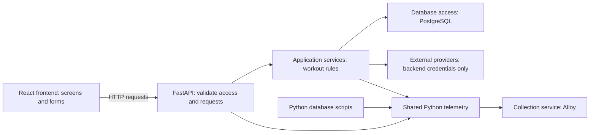

# System overview and code ownership

Design status: **Agreed direction**. Detailed product rules remain governed by
their own design approvals and open questions.

The [Alloy/Mimir observability direction](observability.md) is approved, including
local Mimir filesystem storage and initial application-only log collection.
Docker container-log collection is deferred.

Implementation status: **Application not started**. This document does not
create application code, packages, services, or database tables.

Related work: [Database foundation](https://github.com/dhaval-mistry/unshaken-smart-coach/milestone/1)
and [Local observability foundation](https://github.com/dhaval-mistry/unshaken-smart-coach/milestone/2).
The owner requested this documentation layout and shared-code guidance.

## What exists today

The repository contains project/design/setup documents, agent definitions and
their generator/tests, UI reference images, and a root Compose file defining
PostgreSQL 17. The backend contains database migrations, schema and tests.
There is no FastAPI or React application or working telemetry package yet.

## Planned components



The frontend does not access PostgreSQL directly. The backend checks ownership
and applies the approved product rules. Database constraints add protection for
stored data. Telemetry describes what happened; it is not the source of truth
for workout records and must not change an operation's result when export fails.

Example: when a user completes a set, the application records performance and
starts rest according to the database design. A trace can show how long that
operation took. Logs must not contain the user's lifting weight or credentials.

## Folder responsibilities

| Path | Responsibility |
|---|---|
| `frontend/` | React/TypeScript screens, API calls, and frontend tests |
| `backend/` | FastAPI, application rules, database access, and Python tests |
| `backend/app/telemetry/` | Shared Python log/metric/trace setup and helpers |
| `backend/scripts/` | Backend-specific Python commands that reuse application packages |
| `scripts/` | Repository-wide helpers, such as the agent generator |
| `observability/` | Collection/storage configuration and Grafana provisioning; not application Python code |
| `compose.yaml` | Existing PostgreSQL and future optional local services |
| `tests/` | Cross-system tests and repository-tool tests |
| `docs/` | Maintained designs, decisions, API descriptions, and setup guides |

Paths for application code are the agreed starting layout, not evidence that
those files exist. Create them when the corresponding implementation requires
them; do not fill the repository with empty folders.

## Backend starting layout

```text
backend/
├── app/
│   ├── main.py             FastAPI startup
│   ├── api/                Request/response handlers
│   ├── services/           Approved application rules
│   ├── db/                 Connections and database access
│   └── telemetry/          Shared Python telemetry
├── scripts/                Python commands using app packages
├── migrations/             Versioned database schema changes
├── tests/                  Backend unit and integration tests
├── pyproject.toml          Dependencies and Python requirement
└── uv.lock                 Locked dependency versions
```

Use one backend uv project and the existing root environment conventions.
Coordinate database issue [#3](https://github.com/dhaval-mistry/unshaken-smart-coach/issues/3)
with telemetry issue [#9](https://github.com/dhaval-mistry/unshaken-smart-coach/issues/9).
They must not create competing dependency files or connection settings.
The existing database foundation uses Python 3.12, uv, SQLAlchemy and Alembic.

## Reuse telemetry across callers

FastAPI and standalone Python commands import the same `app.telemetry` package.
Each process initializes it once and shuts it down with a bounded flush.
Business modules request a logger, record a metric, or open a meaningful trace;
they do not configure exporters or Grafana connections themselves.

The [observability design](observability.md#shared-python-package) describes
package files and responsibilities. The [setup guide](../setup/observability.md)
will contain verified startup commands after implementation.

React needs a separate TypeScript/browser integration later; it cannot import
Python code. Future frontend telemetry can share safe field names and trace
context conventions. It is deferred, not included in the current observability
stories. Never put backend provider credentials in the browser.

Database calls made by Python can be instrumented through the shared package.
Monitoring PostgreSQL server health, such as active connections or disk use,
is separate work and not supplied by Python query tracing. Do not put Python
telemetry initialization in SQL migration files.

## Before changing an existing behavior

Read the story, its recorded decisions, relevant designs, and actual code/tests.
If an approved story and a design disagree, identify the conflict and obtain
direction before changing the affected behavior. Update the design and diagrams
in the same reviewed change when a new behavior is approved. Report exactly
what was tested and what remains incomplete.
