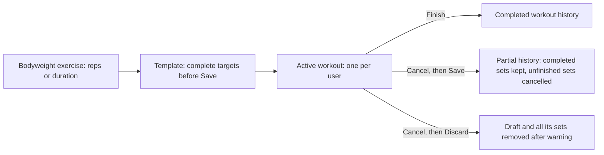

# UNShaken Smart Coach: database design

Design basis: **Reviewed and merged through PR #17**, followed by the owner's
instruction to implement stories #3 and #4 against that design. Confirmed
product answers are retained below. The later timed-bodyweight, template-save,
and Cancel decisions below are **implemented by successor migration
`0003_workout_follow_up`**. Remaining API decisions stay deferred.

Implementation status: **SQLAlchemy/Alembic revisions 0001-0003 implement the database
rules below; workout APIs remain separate work**.
It has not been applied to the owner's existing database. PostgreSQL
17 setup was merged through [PR #16](https://github.com/dhaval-mistry/unshaken-smart-coach/pull/16).
Issue #30 implementation is based on main `a4cafb8c76fc7e33939de9bc4072a64e46c5ebc5`.
It does not connect to or change any database.

Related work: [finalize design #2](https://github.com/dhaval-mistry/unshaken-smart-coach/issues/2),
[versioned tables #3](https://github.com/dhaval-mistry/unshaken-smart-coach/issues/3),
and [master records #4](https://github.com/dhaval-mistry/unshaken-smart-coach/issues/4).
The owner already approved these stories and their master-record lists. Do not
ask for the same story approval again. See [PR #17](https://github.com/dhaval-mistry/unshaken-smart-coach/pull/17)
and the verified-command/status section in [backend setup](../setup/backend.md).

## Confirmed requirements and owner answers

Retain the previously confirmed requirements:

- Google/Microsoft sign-in; authentication implementation is separate work.
- Personal and shared sample templates, ordered exercises, and ordered sets.
- Provider exercises plus only the current user's private custom exercises.
  Shared samples cannot reference private custom exercises.
- Optional lifting weight for every category; NULL is missing, zero is explicit.
- New sets default to 120 seconds of rest, without a configurable user default.
  Completing a set starts rest atomically; retries do not reset its timestamp.
- Ask once at workout finish whether to update the source template. No leaves
  it unchanged; Yes updates a personal source or creates a personal copy of a
  sample. Save the completed workout independently of optional-update success.
- Preserve original starting targets, names/classification, suggested weight/
  unit, and actual performance separately. Later source edits do not rewrite them.
- Ad hoc workouts need no template and remain in history. Saving them as a new
  template is outside this work.
- Custom exercises require name, category, and body part. None is a real
  selectable body-part value, not SQL NULL or an automatic form selection.
- Browser and mobile clients share the same database/API.
- A Bodyweight exercise may use duration instead of reps. Do not require dummy
  reps for a timed Plank. Weight remains optional.
- A template needs at least one exercise and all necessary exercise details
  and targets before Save.
- Cancelling an active workout offers a warning that Discard deletes even
  completed reps. Discard saves no workout. Save keeps completed work and marks
  unfinished exercises cancelled.

The owner answered the remaining initial-scope questions in the issue #2 task
conversation on 2026-11-01:

| Question | Confirmed answer |
|---|---|
| Include time/distance in the first version? | Yes; do not defer Cardio/Duration or require dummy reps |
| Complete a Cardio set | Positive duration **and** positive distance are required |
| Complete a Duration set | Positive duration is required |
| Complete an initially reps-kind set | The existing migration requires positive reps for six categories; the later approved change permits a Bodyweight exercise to use duration instead |
| Weight for any category | Still optional |
| Simultaneous workouts | At most one in-progress workout per user |
| Delete live exercise/template/planned-set sources | Permanent deletion is allowed while workout history is preserved |
| Delete completed workouts or completed sets | No permanent-delete feature in version one; correction/deletion needs later design |

These answers approve behavior, not an unseen SQL implementation. Merged
PR #17 records them. They do not grant a sample-administration role,
account-erasure workflow, or permission to erase retained history.

## Model and initial scope

Keep 13 tables. Exercise definitions, reusable plans, and performed sessions
are separate. A workout such as Afternoon Workout contains exercises such as
Dumbbell Squat. Telemetry, AI coaching, nutrition, billing, and raw health
profiles are not transactional tables in this foundation.

Use UUID application keys, stable SMALLINT lookup keys, decimal weights and
distances (never floating point), and TIMESTAMPTZ event timestamps. Each row in
the dictionary below is one physical column. Paired names such as created_at
and updated_at are separate columns.

Existing choices remain: root Compose PostgreSQL 17, private root environment
conventions, and one backend uv project. The local implementation selects
Python 3.12, SQLAlchemy Core, Psycopg 3, and Alembic. Only commands verified
against disposable PostgreSQL are described as working in the setup guide.

### Measurement representation

Store whole seconds and meters; decimal meter values allow millimeter
precision. For example, ten minutes and 1.5 km become 600 seconds and
1500.000 meters. These canonical units follow the merged design;
preserving a user's entered display unit is not part of this schema.

The existing migration gets a measurement kind from
`exercise_categories.measurement_kind` and copies it to each session exercise.
The approved timed-Bodyweight change needs `exercises.measurement_kind` as the
effective kind for each exercise. Keep the category kind as the usual kind and
default when creating an exercise. Bodyweight may choose `reps` or `duration`;
other categories continue to use their category kind until another change is
approved. Capture the effective exercise kind in each session exercise. A later
catalog or category edit must not reinterpret a past performance.

| Kind | Categories initially | Valid target/actual measurement fields | Completion requires |
|---|---|---|---|
| reps | Barbell, Dumbbell, Machine/Other, Bodyweight when selected, Assisted Bodyweight, Reps Only | reps | Positive actual_reps |
| duration | Duration, or Bodyweight when selected for that exercise | duration_seconds | Positive actual_duration_seconds |
| duration_distance | Cardio | duration_seconds and distance_meters | Both actual values positive |

Proposed minimal rule: unused measurement fields are NULL, not zero or dummy
reps. Targets may be NULL while editing; populated targets/actual values are
positive. Completion uses actuals, never silently copies targets. Weight/unit
pairs stay optional and independent for every kind. Rest may be zero.

The NULL rules and canonical units are technical representation choices from
the merged design. They do not approve target-readiness rules for a future
start-workout API or add optional cross-category measurement features. For
example, a 45-second Bodyweight Plank has kind `duration`, actual duration 45,
NULL reps, and optional NULL weight. Explicit weight zero requires kg or lb;
missing weight stays NULL rather than being silently converted to zero.

### Approved follow-up design: timed Bodyweight, template Save, and Cancel

These rules supersede the earlier reps-only Bodyweight, permissive template
Save, and no-active-session-delete rules. Successor revision
`0003_workout_follow_up` implements the database changes without altering the
frozen `0001`/`0002` migrations. No existing/shared database is upgraded by
this change; application requires separate target approval.

**Template Save.** A save operation checks the complete template in one
transaction. It rejects zero exercises, missing exercise identity/name or
classification, missing required target values for the selected measurement
kind, nonpositive targets, and incompatible fields. Earlier revisions allowed
blank targets. The initial implementation holds incomplete edits in
the client and writes the template plus all children atomically at Save. The
service validates the full plan and a deferred database guard checks the
committed template, including edits/deletion of its last exercise or required
target. A partial transaction cannot leave a published incomplete template.
If stored drafts are later wanted, they need an explicit draft/published state
and guards that prevent an incomplete draft being started. The owner has not
selected a stored-draft feature. The owner confirmed during issue #30
implementation that every included exercise must contain at least one set with valid targets, on both initial Save
and subsequent updates. Incomplete stored drafts are not supported.

**Cancel then Discard.** The client first warns that completed reps, durations,
weights, and rest records in this active workout will be deleted. Only after
explicit confirmation, a scoped database operation locks the user's own
`in_progress` session, deletes its sets and exercises, then the session in one
transaction. It must reject another user's session and every terminal session.
This is the one exception to session history protection: a discarded active
draft has no retained workout or starting-plan snapshot. The transaction frees
the one-active-workout slot. A failed transaction leaves the entire draft
intact. Restrict direct table deletes so callers cannot use this path to erase
completed history; verify the parent status and owner inside the operation.

**Cancel then Save.** Keep the session and all completed sets. Change each
remaining pending set to `cancelled` in the same transaction, leave already
skipped sets as skipped, set the session status to `cancelled`, and set
`finished_at` to the server's event time. A session exercise with any cancelled
set is shown as cancelled; derive this from its sets rather than adding a
second status that could disagree. For example, if Squat set 1 was completed
and set 2 was pending, the saved history retains set 1 and marks set 2 and
that exercise cancelled. The completed set's actuals, `completed_at`, and
rest timestamps remain unchanged. A cancelled set has no actual performance,
completion timestamp, or rest timestamps. A terminal session cannot resume or
be discarded. The `cancelled` session status distinguishes this partial save
from a normally completed workout. No template update is assumed for this
path; whether to offer it remains open.

**Migration and compatibility.** Add `exercises.measurement_kind` using the
existing three values. Backfill existing exercises from their current category
kind, then require a value and enforce the category compatibility above. Keep
existing category seed IDs and names. Change template validation and session
capture guards to use the exercise kind. Existing
`session_exercises.measurement_kind_snapshot` and the JSON starting snapshot
stay immutable and retain their original kind. Add `cancelled` to the
`session_sets.status` check and update the row/cross-table guards: completed
sets still require kind-specific actuals and timestamps; cancelled sets allow
no actuals or completion/rest events. Add the deferred template completeness
guard on the template and its children, requiring at least one set per exercise; its
check must cover insert, edit, and child removal. Design a narrow in-progress discard
operation with child-delete permission and protect terminal sessions and sets.
The existing one-active partial index remains. Preflight any existing
`cancelled` sessions with pending sets before changing their meaning; do not
silently rewrite historical rows. Check existing template rows for incomplete
targets before enforcing a published-template invariant; report and resolve
conflicts rather than deleting or inventing values.

**Validation expected on a disposable PostgreSQL 17 database.** A timed
Bodyweight exercise and template set accept positive duration and NULL reps;
a reps-based Bodyweight exercise still needs positive reps. Wrong or mixed
measurement fields, missing weight unit, and nonpositive targets/actuals fail.
Saving an empty or incomplete template fails atomically. Concurrent starts
still allow only one active session per user. Discard confirmation deletes
only the owner's active draft, including completed draft sets, and a failed
discard rolls back. Cancel then Save retains completed performance and the
starting plan, marks pending sets cancelled, sets the terminal time, and
releases the active slot. Delete attempts against completed or saved-partial
history fail. Existing exercises, snapshots, template data, and seeds survive
the migration without a category or historical measurement change.

## Table dictionary

See the [Mermaid source](er-diagram.mmd) and matching
[rendered diagram](er-diagram.md). Diagrams show live FKs only; immutable
original UUIDs deliberately are not FKs and survive source deletion.
Mermaid cannot express the cross-table, JSON, or partial-index guards below.

### users

| Column | PostgreSQL type | Rules and meaning |
|---|---|---|
| id | UUID | Primary key. |
| display_name | VARCHAR(150) | Required; trimmed and nonblank. |
| contact_email | VARCHAR(320) | Nullable; not a unique login key. |
| preferred_weight_unit | VARCHAR(2) | Required; kg or lb. No database default; caller supplies explicitly. |
| status | VARCHAR(20) | Required; active or disabled. |
| created_at | TIMESTAMPTZ | Required; server creation timestamp, immutable. |
| updated_at | TIMESTAMPTZ | Required; server-maintained modification timestamp. |

Contact email is not globally unique. Authentication resolves user_identities, never an email-only match. No database weight-unit default is proposed: callers must supply kg/lb, while any onboarding default remains a later product decision.

### user_identities

| Column | PostgreSQL type | Rules and meaning |
|---|---|---|
| id | UUID | Primary key. |
| user_id | UUID | Required FK users. |
| provider | VARCHAR(20) | Required; google or microsoft. |
| issuer | TEXT | Required; validated OIDC issuer. |
| subject | TEXT | Required; validated subject within issuer. |
| email_at_login | VARCHAR(320) | Nullable. |
| email_verified | BOOLEAN | Nullable if provider does not supply it. |
| last_login_at | TIMESTAMPTZ | Nullable. |
| created_at | TIMESTAMPTZ | Required; server creation timestamp. |

Unique (provider, issuer, subject). Never store provider passwords or automatically link accounts by email. Provider-token validation and application sessions/refresh-token persistence are separate authentication work.

### exercise_categories

| Column | PostgreSQL type | Rules and meaning |
|---|---|---|
| id | SMALLINT | Stable seed identifier. |
| name | VARCHAR(50) | Required; unique. |
| sort_order | SMALLINT | Required; unique within this table. |
| measurement_kind | VARCHAR(20) | Required; reps, duration, or duration_distance. Usual kind for exercises in this category; the approved Bodyweight exception is chosen on the exercise. |
| is_active | BOOLEAN | Required; default true. |

Versioned seeds carry stable IDs, names, sort order, measurement kind, and initially active=true. Proposed ID/order mapping: 1 Barbell/reps; 2 Dumbbell/reps; 3 Machine/Other/reps; 4 Bodyweight/reps; 5 Assisted Bodyweight/reps; 6 Reps Only/reps; 7 Cardio/duration_distance; 8 Duration/duration. The names/order are already approved; this explicit ID mapping is technical proposal for #4. Deactivate master choices rather than changing their meaning. A measurement-kind change affecting references needs a reviewed migration.

### body_parts

| Column | PostgreSQL type | Rules and meaning |
|---|---|---|
| id | SMALLINT | Stable seed identifier. |
| name | VARCHAR(50) | Required; unique. |
| sort_order | SMALLINT | Required; unique within this table. |
| is_active | BOOLEAN | Required; default true. |

Approved ordered values: None; Arms; Back; Cardio; Chest; Core; Full Body; Legs; Olympic; Other; Shoulders. Proposed stable IDs/sort orders are 1 through 11 in that order, initially active=true. None is required as a deliberate selected record. Adding a later master record or column requires a new versioned migration; do not rewrite an applied migration.

### exercises

| Column | PostgreSQL type | Rules and meaning |
|---|---|---|
| id | UUID | Primary key. |
| name | VARCHAR(200) | Required; trimmed, nonblank; duplicates allowed. |
| category_id | SMALLINT | Required FK exercise_categories. |
| body_part_id | SMALLINT | Required FK body_parts. |
| measurement_kind | VARCHAR(20) | Required effective reps/duration/duration_distance kind. Backfill existing rows from category. Bodyweight may be reps or duration; other categories match their category kind. |
| source_type | VARCHAR(20) | Required; provider or custom. |
| description | TEXT | Nullable. |
| is_active | BOOLEAN | Required; default true; does not prohibit approved permanent deletion. |
| created_at | TIMESTAMPTZ | Required; server creation timestamp, immutable. |
| updated_at | TIMESTAMPTZ | Required; server-maintained modification timestamp. |

A provider/custom subtype must exist exactly once and match source_type at transaction end. Database guards cover parent and subtype changes. Changing an exercise's effective measurement kind while a live template uses it must also leave every planned set valid; reject incompatible edits until the plan is explicitly changed. Editing names/classification must never rewrite historical session copies. Catalog deletion is allowed after explicit removal/replacement from live reusable plans; history itself does not block deletion.

### provider_exercises

| Column | PostgreSQL type | Rules and meaning |
|---|---|---|
| exercise_id | UUID | Primary key and required FK exercises; matching provider subtype. |
| provider_name | VARCHAR(50) | Required; exercisedb initially. |
| provider_exercise_id | TEXT | Required; stable provider identifier. |
| provider_body_part | TEXT | Nullable; original provider label, separate from equipment. |
| provider_equipment | TEXT | Nullable; original equipment label. |
| instructions | JSONB | Nullable; ordered array of instruction strings. |
| target_muscles | JSONB | Nullable; array of primary muscle labels. |
| secondary_muscles | JSONB | Nullable; separate array of secondary muscle labels. |
| media_references | JSONB | Nullable; array of URL/metadata objects, subject to agreed provider terms. |
| raw_payload | JSONB | Nullable; provider response object, never credentials/headers. |
| last_synced_at | TIMESTAMPTZ | Required. |
| provider_updated_at | TIMESTAMPTZ | Nullable; only when supplied by provider. |

Unique (provider_name, provider_exercise_id). These are internal fields, not a verified ExerciseDB payload contract. Validate populated JSON shapes. Provider version, import/mapping, caching/media terms and synchronization behavior remain separate integration decisions. No real provider request is needed to verify this foundation.

### custom_exercises

| Column | PostgreSQL type | Rules and meaning |
|---|---|---|
| exercise_id | UUID | Primary key and required FK exercises; matching custom subtype. |
| created_by_user_id | UUID | Required FK users; private creator ownership. |

Name/category/body part live in exercises, not duplicated here. Insert base and subtype together. Custom exercises are creator-only, including direct IDs and attachment to plans/sessions. Personal plans and sessions may use only provider exercises or custom exercises owned by that plan/session user. Samples use provider exercises only. Database guards preserve write invariants; future user-scoped queries still enforce read access.

### workout_templates

| Column | PostgreSQL type | Rules and meaning |
|---|---|---|
| id | UUID | Primary key. |
| owner_user_id | UUID | Nullable FK users; required for personal, NULL for sample. |
| template_type | VARCHAR(20) | Required; sample or personal. |
| name | VARCHAR(150) | Required; trimmed and nonblank. |
| notes | TEXT | Nullable. |
| copied_from_template_id | UUID | Nullable live FK workout_templates; SET NULL when source is deleted. |
| copied_from_template_id_snapshot | UUID | Nullable immutable original copy-source UUID; intentionally not an FK. |
| version | INTEGER | Required; default 1; positive. Increment on relevant approved edits. |
| archived_at | TIMESTAMPTZ | Nullable; optional existing representation, not a mandatory substitute for deletion. |
| created_at | TIMESTAMPTZ | Required; server creation timestamp, immutable. |
| updated_at | TIMESTAMPTZ | Required; server-maintained modification timestamp. |

Require owner/type consistency. A copied template preserves its original source UUID after the live source is deleted. At copy creation, that UUID must match a valid live source; it cannot be invented as an orphan. The optional archived_at field remains available, but archiving is not mandatory instead of the approved permanent deletion. Sample management permissions remain separate work.

### template_exercises

| Column | PostgreSQL type | Rules and meaning |
|---|---|---|
| id | UUID | Primary key. |
| template_id | UUID | Required FK workout_templates. |
| exercise_id | UUID | Required FK exercises; explicit removal/replacement from live plans precedes catalog deletion. |
| position | INTEGER | Required; positive; unique per template. |
| notes | TEXT | Nullable. |

Unique (template_id, position); repeated exercise IDs are allowed. Reordering needs deferrable ordering uniqueness or a safe temporary-position transaction. The required exercise FK is a deliberate live-plan protection: do not automatically delete or break reusable plans when a catalog exercise is removed. Explicitly remove/replace the entry first; deleting the entire template may delete its own live entries/sets.

### template_sets

| Column | PostgreSQL type | Rules and meaning |
|---|---|---|
| id | UUID | Primary key. |
| template_exercise_id | UUID | Required FK template_exercises. |
| set_number | INTEGER | Required; positive; unique per template exercise. |
| target_reps | INTEGER | Nullable while editing; positive when supplied; reps kind only. |
| target_duration_seconds | INTEGER | Nullable while editing; positive whole seconds when supplied; duration/duration_distance kinds. |
| target_distance_meters | NUMERIC(12,3) | Nullable while editing; positive meters when supplied; duration_distance kind only. |
| suggested_weight | NUMERIC(10,3) | Nullable; nonnegative; allowed for every kind. |
| weight_unit | VARCHAR(2) | Nullable; kg/lb iff suggested_weight is supplied. |
| rest_seconds | INTEGER | Required; default 120; nonnegative. |

Unique (template_exercise_id, set_number). Validate fields against the referenced exercise's effective `exercises.measurement_kind`, including when a live exercise/category changes. Revision 0003 checks the effective exercise kind. Targets may be absent only in an unsaved edit; Save and Start must reject a missing required target. Every saved template exercise must have at least one valid set.

### workout_sessions

| Column | PostgreSQL type | Rules and meaning |
|---|---|---|
| id | UUID | Primary key. |
| user_id | UUID | Required FK users. |
| source_template_id | UUID | Nullable live FK workout_templates; SET NULL after source deletion. |
| source_template_id_snapshot | UUID | Nullable immutable original source UUID; not an FK; remains after deletion. |
| source_template_type_snapshot | VARCHAR(20) | Nullable immutable sample/personal source kind. |
| source_template_version | INTEGER | Nullable immutable positive source version; paired with original source UUID. |
| name_snapshot | VARCHAR(150) | Required immutable session name captured at start. |
| starting_plan_snapshot | JSONB | Physically nullable only during initial capture; deferred guard requires a validated non-NULL object at commit. Immutable once populated; see snapshot contract. |
| status | VARCHAR(20) | Required; in_progress, completed, or cancelled; terminal states cannot rewind. |
| started_at | TIMESTAMPTZ | Required; server event timestamp. |
| finished_at | TIMESTAMPTZ | Required for completed/cancelled; NULL while in_progress; >= started_at. |
| notes | TEXT | Nullable. |
| template_updated_at | TIMESTAMPTZ | Nullable; retained successful optional-write timestamp. |
| template_update_requested | BOOLEAN | Nullable until explicit choice; NULL for not applicable. |
| template_update_status | VARCHAR(20) | Required; not_applicable, pending, declined, applied, or conflict. |
| applied_template_id | UUID | Nullable live FK workout_templates; SET NULL if successful target is later deleted. |
| applied_template_id_snapshot | UUID | Nullable original successful target UUID; retained when live target is deleted. |
| created_at | TIMESTAMPTZ | Required; server creation timestamp, immutable. |
| updated_at | TIMESTAMPTZ | Required; server-maintained modification timestamp. |

Template-backed versus ad hoc is determined from source_template_id_snapshot, not the nullable live source_template_id. A deleted source does not turn a historical template workout into an ad hoc workout. Original source UUID, kind, version and starting snapshot stay immutable for retained sessions. Enforce one in_progress row per user with a partial unique index. Completed/cancelled cannot return to in_progress. The approved, confirmed Discard operation may remove an owned in-progress draft and all children; terminal sessions remain protected.

### session_exercises

| Column | PostgreSQL type | Rules and meaning |
|---|---|---|
| id | UUID | Primary key. |
| session_id | UUID | Required FK workout_sessions; no parent history cascade. |
| exercise_id | UUID | Nullable live FK exercises; SET NULL after catalog deletion. |
| exercise_id_snapshot | UUID | Required immutable original exercise UUID; intentionally not an FK. |
| exercise_source_type_snapshot | VARCHAR(20) | Required immutable provider/custom source kind. |
| source_template_exercise_id | UUID | Nullable live FK template_exercises; SET NULL after planned-source deletion. |
| source_template_exercise_id_snapshot | UUID | Nullable immutable original template-entry UUID; not an FK. |
| name_snapshot | VARCHAR(200) | Required immutable captured exercise name. |
| category_snapshot | VARCHAR(50) | Required immutable captured category name. |
| body_part_snapshot | VARCHAR(50) | Required immutable captured body-part name. |
| measurement_kind_snapshot | VARCHAR(20) | Required immutable effective exercise kind (reps/duration/duration_distance); drives completion independently of later catalog edits or labels. |
| position | INTEGER | Required; positive; unique per session. |
| notes | TEXT | Nullable. |

Unique (session_id, position). At capture/insertion, validate a real accessible exercise, matching name/category/body-part/effective-measurement-kind snapshots, and any template-entry lineage. Afterward snapshots and original IDs cannot change for a retained session. A catalog or source-entry delete detaches only its live FK. Session-exercise rows are retained in saved history; confirmed Discard deletes the entire active draft. This revision does not grant a separate exercise-entry deletion/reorder feature inside a workout.

### session_sets

| Column | PostgreSQL type | Rules and meaning |
|---|---|---|
| id | UUID | Primary key; generate a fresh UUID for new rows; retained initial UUIDs cannot be reused. |
| session_exercise_id | UUID | Required FK session_exercises. |
| source_template_set_id | UUID | Nullable live FK template_sets; SET NULL after planned-source deletion. |
| source_template_set_id_snapshot | UUID | Nullable immutable original planned-set UUID; not an FK. |
| set_number | INTEGER | Required; positive; unique per session exercise; additions follow retained initial/existing numbers. No extra ledger tracks discarded post-start unperformed additions. |
| target_reps_snapshot | INTEGER | Nullable immutable starting reps; positive when supplied; reps kind only. |
| target_duration_seconds_snapshot | INTEGER | Nullable immutable starting duration; positive whole seconds; duration/duration_distance kinds. |
| target_distance_meters_snapshot | NUMERIC(12,3) | Nullable immutable starting distance; positive meters; duration_distance kind only. |
| suggested_weight_snapshot | NUMERIC(10,3) | Nullable immutable starting suggested weight; nonnegative. |
| suggested_weight_unit_snapshot | VARCHAR(2) | Nullable immutable kg/lb iff suggested weight snapshot is supplied. |
| actual_reps | INTEGER | Nullable until completion; positive when supplied; required for completed reps kind only. |
| actual_duration_seconds | INTEGER | Nullable until completion; positive whole seconds; required for completed duration/duration_distance kinds. |
| actual_distance_meters | NUMERIC(12,3) | Nullable until completion; positive meters; required for completed duration_distance kind only. |
| actual_weight | NUMERIC(10,3) | Nullable; nonnegative; optional for every category. |
| weight_unit | VARCHAR(2) | Nullable; kg/lb iff actual_weight is supplied. |
| status | VARCHAR(20) | Required; pending, completed, skipped, or cancelled. Cancelled means unfinished when the user saves a partial workout. |
| completed_at | TIMESTAMPTZ | Required iff completed; retained and immutable after completion. |
| rest_seconds | INTEGER | Required; default 120; nonnegative. |
| was_in_starting_plan | BOOLEAN | Required; true iff this execution row belongs to the immutable initial plan. |
| rest_started_at | TIMESTAMPTZ | Required iff completed; equals completed_at on first completion; retry never resets it. |
| rest_ended_at | TIMESTAMPTZ | Nullable; if set requires start and >= start. Further timer operations need their own design. |
| created_at | TIMESTAMPTZ | Required; server creation timestamp, immutable. |
| updated_at | TIMESTAMPTZ | Required; server-maintained modification timestamp. |

Unique (session_exercise_id, set_number). Original targets and source UUID are immutable for retained sessions. Starting rows must match starting_plan_snapshot exactly; additions are marked false and do not claim original template-source lineage or starting targets. Completed rows retain actual values and completion/rest timestamps in retained history. A cancelled set has no actuals, completion timestamp, or rest timestamps; the parent `finished_at` records the partial-save event. Only a never-completed, unperformed row in an in-progress session may be removed individually. The separate confirmed Discard operation removes the entire active draft, including completed rows, after the warning.

## Immutable starting-plan snapshot and capture boundary

### Why a snapshot object is needed

The owner permits permanent removal of live sources and unperformed set rows,
while requiring starting-plan and completed-performance history to survive.
An immutable JSONB copy of the initial plan provides that evidence without a
fourteenth table. It is structured data with a strict contract, not arbitrary
provider JSON or a dump of private request bodies.

Example: the original plan had set 2 targeting 600 seconds and 1500 meters.
The participant removes that unperformed execution row. The row can be
permanently deleted, but the initial plan still shows what was originally
planned. This is intentional history retention, not total erasure of every
reference to the removed object.

### Version-one JSON contract

The root object has exactly schema_version=1, source, and exercises. Source
is JSON null for ad hoc, otherwise an object containing template_id (UUID
string), template_type (sample/personal), and version (positive integer).
These values match the session's immutable source columns.

Each exercises array item contains:

- session_exercise_id and exercise_id (UUID strings); exercise_source_type
  (provider/custom); source_template_exercise_id (UUID string or null).
- name, category, body_part (captured nonblank strings), measurement_kind
  (one of the three known kinds), position (positive integer), and sets.
- Each sets item contains session_set_id, source_template_set_id (UUID string
  or null), set_number, target_reps, target_duration_seconds,
  target_distance_meters, suggested_weight, suggested_weight_unit, rest_seconds.
- Reps/duration/set numbers/rest are JSON integers or allowed nulls. Distances
  and weights are decimal strings with at most three fractional digits or null,
  avoiding a floating-point round trip. UUIDs and all field types are validated.
- Apply the same positive-value, effective exercise measurement-kind, and
  weight/unit rules as the relational targets. Required fields must exist even
  when their value is null.
  Reject unknown keys, duplicate IDs/positions/set numbers, and incorrect arrays.
- Arrays follow position/set_number order. The copy contains every initial
  exercise/set, including ad hoc starting entries if supplied. It excludes
  actual performance, credentials, raw provider payloads, and user notes.

### Atomic capture operation

The proposed database capture boundary is explicit:

1. In one transaction, insert the in-progress session with
   starting_plan_snapshot temporarily SQL NULL. Reserve its one-active slot.
2. Validate live owner/source rows and insert all initial session exercise/set
   rows. Initial set insertion is allowed only while that session's snapshot
   is NULL. Validate real source lineage, not merely supplied original UUIDs.
3. Populate the snapshot once. A database guard validates its full shape and
   exact IDs, order, source metadata, and target equality against the initial
   relational rows while those live rows/sources are present.
4. A deferred constraint trigger rejects commit if capture is still NULL or
   inconsistent. Only a complete, validated snapshot may exist after commit.
   Later attempts to reset, replace, or edit the populated snapshot fail.

The physical JSONB column must therefore allow SQL NULL during this creation
transaction. Its committed non-NULL invariant is enforced by the deferred
constraint trigger, **not** a fictitious deferrable NOT NULL constraint.
No half-captured session can commit.

After capture, new execution sets must be additions. They may not reuse an ID
or set number from the immutable initial plan or claim was_in_starting_plan=true.
Removing an initial unperformed row does not reopen capture or allow that row
to be recreated with a different target/performance identity. New sets use new
UUIDs and a free number beyond retained initial/existing numbers.

A session exercise inserted after capture is not an initial-plan entry and
cannot claim captured template-entry lineage. It still needs a valid accessible
catalog source and matching immutable classification. This storage guard does
not grant an additional exercise-edit/addition API permission.

No extra audit ledger is proposed for deleted, never-performed additions that
were not in the starting plan. Do not claim that every such discarded draft
value is retained or impose a global set-number history feature without a
separate requirement.

## Workflow and transaction rules

### Identity, catalog and source changes

Resolve validated (provider, issuer, subject) atomically in future login code.
Read only provider exercises and the user's private custom exercises before
searching/counting/pagination; apply the same access rules to direct IDs.
An unguessable UUID is not authorization.

Changing source_type, custom ownership, template ownership/type, or source
relationships must not invalidate existing live attachments. Guards cover
changes to parents as well as child inserts. Name/classification edits do not
rewrite session snapshots. Live template target compatibility must be checked
when its exercise/category changes. Keep unsupported provider operations out
of this foundation.

### Start, complete, and rest

Start captures the source UUID/version, ordered initial plan, classification,
measurement kind and target values atomically as above. Samples are captured
directly; do not create a personal copy just to start a workout. New sets
receive concrete rest_seconds=120, and ad hoc workouts do not create templates.

Completing a set must submit the actual required measurement for its captured
kind. Cardio needs duration and distance; Duration and a duration-kind
Bodyweight exercise need duration; a reps-kind exercise needs reps. Never
infer actuals from targets or require weight. A row/constraint guard rejects
a mismatched or missing measurement.

Lock or conditionally transition the pending set once, setting completed_at
and rest_started_at to the same server event time. Retrying an already
completed set returns the recorded result and original timestamps; it does
not restart rest or overwrite actuals. Remaining rest is calculated from the
stored start plus rest_seconds, without a write every second.

Completed performance in retained sessions and terminal session status cannot
be rewound to make a delete appear to concern an unperformed row. The approved
Discard operation is limited to a confirmed, owned, in-progress draft. Further
timer adjustment, skip/undo, pause/resume, and correction behavior remain
future API decisions.

### Finish and optional template update

Ask once at finish, persist completed performance and the explicit choice
durably, then attempt the optional template write in a separate transaction.
Failure, decline, or conflict cannot erase the completed workout.

| Outcome | Required stored relationship |
|---|---|
| not_applicable | Ad hoc original source is NULL; choice, applied UUIDs and update time NULL |
| pending | Original template source exists in history; choice NULL before answer or true while approved write awaits processing; no applied result |
| declined | Choice false; original source retained; no applied UUIDs or update time |
| applied | Choice true; completed session; original successful target UUID and update timestamp required; live target may later be NULL after deletion |
| conflict | Choice true; original source retained; unavailable/changed source; no applied result or update time |

For a personal source, a successful target's original UUID equals the original
source UUID. For a sample, create one personal copy owned by the session user,
with copied_from_template_id_snapshot equal to that original sample UUID.
At apply time both the source and target rows must exist and be authorized;
validate type/owner/version and copy lineage before recording applied.

If the source is deleted before finish/apply, preserve completion and record
a conflict/unavailable optional update; do not silently recreate the deleted
template from the snapshot. If a successfully applied target is deleted later,
SET NULL only its live FK. Keep applied status, original target UUID and
template_updated_at: the historical success did happen.

Retries reuse a recorded result and must not create a second sample copy.
Transient optional-write failure can remain pending with choice=true for a
later agreed retry. Exact field mapping, blank-weight handling, skipped/
removed-set mapping, late completions, conflict resolution, retry expiry,
template-update behavior for a saved partial session, and changing a saved
answer require future service design; the schema does not silently choose
those behaviors.

### Previous performance

The owner confirmed that previous performance for an exercise spans workouts
inside and outside the current template. Use the user's retained sessions and
original exercise UUID, including when the live exercise is gone; never match
another user's performance. Repeated-exercise/set matching and inclusion of
completed sets from saved partial sessions remain open.
Do not store a stale previous_weight copy or silently relabel kg as lb.

## Permanent deletion while preserving history

Permanent source deletion is allowed; mandatory archiving/RESTRICT against all
historical references is no longer the design. The existing source/history
mechanics are in local database guards. Discard and saved-partial set status
below still need a new migration and service operation.

| Relationship or operation | Proposed behavior |
|---|---|
| Referenced master category/body part | RESTRICT while live exercises reference it; stable masters are not the requested source-deletion feature |
| Exercise referenced by a live reusable template entry | RESTRICT until the owner explicitly removes/replaces that entry; no hidden cascade or broken reusable plan |
| Exercise referenced only by sessions | Delete exercise; SET NULL session_exercises.exercise_id; retain original UUID, snapshots, starting plan and performance |
| Exercise to provider/custom subtype | CASCADE matching details when its base is intentionally deleted; subtype cannot be deleted alone leaving an invalid base |
| Delete a template | CASCADE its live template_exercises/template_sets; SET NULL session live source links; retain original UUIDs and starting-plan JSON |
| Delete a planned template entry or set | CASCADE only its live planned children as applicable; SET NULL historical live links, retain original IDs/targets |
| Delete a template used as a copy source | SET NULL copied_from_template_id; preserve copied_from_template_id_snapshot |
| Delete previously applied personal target | SET NULL applied_template_id; preserve applied_template_id_snapshot, applied status and update time |
| Delete an unperformed session set | While session is in_progress, allow physical removal only if it has never completed and has no submitted actual performance or rest/completion timestamps; initial plan remains in JSON |
| Delete a completed set or rewind it to pending/skipped | Reject; correction/deletion needs a separately approved feature |
| Discard an active draft after warning and confirmation | Delete its sets, exercise rows, and session atomically through the scoped operation; completed draft performance is intentionally discarded |
| Delete a completed or saved-partial session, including parent cascades | Reject; retained history has no permanent-delete workflow |
| Delete a session exercise | Retain captured execution parent; this revision grants source/catalog and unperformed-set deletion, not a new in-workout entry deletion feature |
| Hard-delete a user with retained data | RESTRICT initially; account erasure is a separate product/security design |

Example: deleting an exercise used by two reusable templates first requires
explicitly removing/replacing its entries in both plans. This is the proposed
non-silent live-plan protection. Its past workouts do not block catalog deletion,
because historical references detach while captured evidence remains. Human
review can change this live-plan prerequisite; it is not a newly confirmed
requirement to archive every exercise.

### Live links versus original identity

Live FK NULL and original UUID NULL mean different things. Each nullable live
link has an intentionally non-FK original UUID where history/provenance needs
to survive. Validate that pair against a real authorized source on capture/copy/
apply; no arbitrary orphan original-UUID insertion is allowed.

Afterward, a populated live FK must equal its immutable original UUID. A live
FK may become NULL only when that exact source no longer exists. A deferred
guard distinguishes a genuine source deletion from manually clearing a link
while the source remains. Original source IDs already retained by history must
not be reused for a fresh catalog/template/planned row or silently reattached
as a different identity. Validate that on source insertion against the relevant
original-ID fields and retained initial-plan evidence.

Preserve original parentage too: an initial source template-entry/set belongs
to the captured original template/exercise chain. Compare those immutable IDs
and initial JSON after deletion; never treat a missing live source as permission
to invent a new lineage. All before-deletion capture/apply validations still
require actual owner/source rows.

Only the exact live-FK detachment is allowed on otherwise immutable historical
rows. It may not change original UUIDs, snapshots, order, performance, status,
or completion/rest event times. Database-maintained updated_at may reflect the
detachment. Do not implement a general “cascade bypass” of immutability or
ownership checks. Test attempted mixed detachment/performance edits as invalid.

## Constraints, indexes and enforcement

### Row constraints and ordinary keys

- Primary keys and FKs as in the dictionary, with explicit deletion actions
  above. UUID keys and captured IDs are not renamed through ON UPDATE CASCADE.
- Unique identity/provider keys; unique lookup names/order; unique positions
  per template/session; unique set numbers per exercise occurrence.
- Required column nullability as listed. The one physical-null exception is
  starting_plan_snapshot during atomic capture, with a deferred committed-row guard.
- Allowed enums, trimmed nonblank names, positive populated measurements and
  order/set numbers, nonnegative weight and rest. Decimal precision is explicit.
- Suggested and actual weight/unit pairs are independent: value NULL iff unit
  NULL; populated value requires kg/lb. Zero weight is valid.
- in_progress requires finished_at NULL; completed/cancelled requires
  finished_at >= started_at. completed_at/rest_started_at are required iff the
  set is completed and initially equal. A rest end requires start and >= start.
  Cancelled sets have no performance or rest events; the parent finish time
  records when the partial workout was saved.
- A unique partial index on workout_sessions(user_id) where
  status='in_progress' enforces the confirmed one-active rule under concurrency.
  Never delete a user's data to fix duplicates found by a later migration.

### Cross-table and immutable-history guards

Issue #3 implemented the earlier foundation guards. The approved follow-up
rules require a new migration that extends those guards; a future service
check alone is insufficient. Use ordinary checks/FKs where possible and
deferred constraint triggers where complete transaction state is needed.

| Invariant | Proposed enforcement and verification |
|---|---|
| Exactly one matching provider/custom subtype | Transaction-end guards on exercises and both subtype tables; invalid/missing/duplicate/wrong subtype or unsafe parent edit fails |
| Ownership/source lineage | Guards on parent and child changes; cross-user custom references, custom-in-sample, mismatched original template/entry/set and applied copy targets fail |
| Valid initial capture | One-time shape/mirror validation plus deferred committed non-NULL check; malformed JSON, missing/mismatched initial rows, forged original IDs and unsealed commit fail |
| Snapshot/performance immutability | Reject edits to initial JSON/original IDs/targets; completed actuals/events and terminal statuses cannot rewind; only narrowly checked live-FK detachments allowed |
| Correct measurement mode | Resolve a live template set through the exercise's effective kind, or use the immutable session kind; wrong/missing required actuals and populated unused fields fail, even with renamed labels |
| Event chronology | Cross-table checks put set completion/rest/removal operations within the parent's allowed chronology; no performance writes after terminal status |
| Safe physical removal | Restrict ordinary row deletes to an unperformed set in an in-progress parent. Only the scoped, confirmed Discard operation may remove every row of an owned active draft; reject terminal parent/child deletes and bypass attempts |
| No duplicate active workout | Partial unique index; verify competing transactions/in-progress status changes, then slot release on terminal transition |
| Timestamp maintenance | Server defaults and update trigger; preserve created_at and event timestamps rather than trusting caller-updated updated_at |
| Source deletion and later UUID reuse | Exact SET NULL detachment with originals retained; reject forged orphan capture/reassignment, mixed historical edits, or reinserted source IDs that would impersonate retained history |

Local implementation details: ordinary row checks/FKs and BEFORE/deferred
triggers implement these guards. A transaction advisory lock currently
serializes foundation writes, and deferred validation inspects complete stored
state; this is a correctness-first local baseline, not a throughput claim.
The locked optional-update primitive checks the captured source version before
future mapping writes; no mapping or retry API is implemented. TRUNCATE is
rejected by statement guards, but a privileged schema owner can alter guards.

Database guards validate stored relationships; they are not authentication and
do not grant a user permission to issue arbitrary SQL. A privileged database
owner can alter/disable schema protections; application access control and least
privilege still belong to implementation/security work.

PostgreSQL row CHECKs cannot enforce another table's changing contents.
Constraint triggers can run at transaction end; NOT NULL/CHECK themselves are
not deferrable. These distinctions were checked against PostgreSQL 17 docs:
[constraints](https://www.postgresql.org/docs/17/ddl-constraints.html),
[constraint triggers](https://www.postgresql.org/docs/17/sql-createtrigger.html),
[SET CONSTRAINTS](https://www.postgresql.org/docs/17/sql-set-constraints.html).

### Indexes

Index referencing FKs used in joins/deletion checks; a PK/shared-subtype PK
already supplies its index. Include:

- workout_templates(owner_user_id, archived_at).
- workout_sessions(user_id, started_at DESC) and (user_id, status), plus the
  unique in-progress partial index.
- custom_exercises(created_by_user_id).
- exercises(lower(name), id) for stable name ordering.
- Original source/exercise/target UUID columns used by history lookup and
  anti-reassignment guards, in addition to live FK indexes.

Do not add speculative JSONB indexes. Ordinary name filtering, collation/
accent behavior and any pg_trgm index need the search story's measured queries.
Do not install an extension just because it may be useful later.

## Remaining future decisions and review boundary

The owner has resolved the initial measurement requirements, timed Bodyweight,
one-active policy, permanent source deletion with preserved retained history,
template Save completeness, and the Cancel warning/Discard/partial-Save choice.
Do not reopen these answers or approved seed names. The Discard exception
applies only to an active draft; it does not grant deletion of saved history.

The following still need their future feature designs; this document proposes
keeping them outside the physical foundation rather than inventing behavior:

1. Custom-exercise editing details and completed-performance correction/undo.
2. Previous-performance repeated-exercise/set matching; scope across templates
   is approved, while saved-partial inclusion remains open.
3. Exact template-update mapping, changed units, conflict/retry
   resolution/expiry, whether a saved partial workout offers a template update,
   and late-finish behavior.
4. ExerciseDB version, payload mapping, caching/media terms and sync operations.
5. Timer adjustment, skip, undo, pause/resume.
6. Account linking/application-session storage, onboarding unit default,
   sample administration, account erasure.
7. In-workout exercise removal/reordering beyond the specific unperformed-set
   operation remains undecided. The owner has resolved template completeness:
   at least one exercise and at least one valid set per included exercise.
8. Whether a Bodyweight exercise's effective kind can change after it appears
   in a live template, and whether Assisted Bodyweight also needs duration.

No API implementing those behaviors is included in #3/#4. Revision 0003 implements the approved database follow-up.
Workout API implementation and the remaining product rules stay separate. Do not rewrite the initial migration or
pretend this document settled the remaining product rules.

PR #17 supplied the reviewed representation for canonical units, unused-field
NULL rules, one-time JSON capture, original UUIDs/live links, and deletion
boundaries. The owner subsequently requested local implementation of #3/#4.
Review the local code and verification evidence before publishing; no further
approval of the same master values or confirmed product rules is being requested.

## Verification and handoff for migration implementation

The local implementation adds SQLAlchemy metadata, frozen Alembic schema/guard
SQL, a separate versioned master-data migration, target confirmation tooling,
and PostgreSQL integration tests. Diagrams/dictionary stay synchronized.
Verification runs only on disposable PostgreSQL 17. The owner's development
database is not migrated by this work. Publication and application remain separately reviewed actions.

Required future evidence includes fresh upgrade, all keys/indexes/guards,
invalid rows and concurrent active-workout attempts, measurement boundaries,
capture commit/immutability/removal cases, all source-deletion scenarios,
preserved completed history/original lineage, optional-update result retention,
safe timestamps, and disposable-only downgrade/upgrade limitations. Do not call
real ExerciseDB/model services. Report exact commands, commit and limitations.

Before later applying migrations to any existing/local/shared database, show
only its nonsecret host, port, database name, current revision and planned
changes; obtain the owner's authorization for that target. Never print secrets
or a full connection string, drop data, or recreate volumes as routine setup.

Logs/metrics/traces use shared telemetry and the maintained observability
design. Do not store telemetry in these tables or log weights, measurements,
notes, tokens, raw snapshots, SQL parameters, or credentials.

Review the local code and validation results before publishing. No follow-on role is invoked automatically; merges, existing-target upgrades
and deployments remain human-authorized actions.

