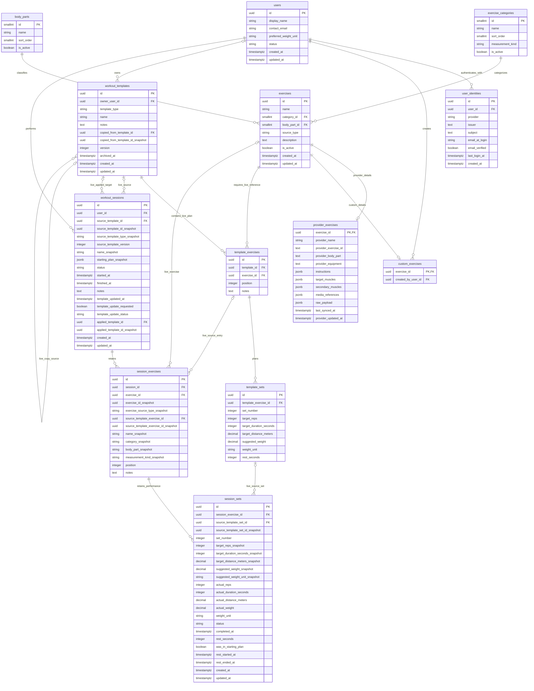

# UNShaken database ER diagram

Design basis: **Reviewed PR #17**, followed by local implementation of stories
#3/#4. See the [detailed design](design.md) and [setup guide](../setup/backend.md).
The model retains 13 tables. The owner's existing database is not migrated.

This diagram shows live foreign keys. Immutable original UUID columns
intentionally are not FKs: source deletion may clear a live link while its
original identity, starting plan, and completed performance remain stored.
Exercise deletion does not cascade into reusable plans; explicit removal/
replacement of live plan references is proposed before catalog deletion.

A unique partial index enforces one in-progress workout per user. Category
measurement_kind and its session snapshot distinguish reps, duration and
duration-plus-distance independently of display labels. Targets, starting
snapshots, and actuals remain separate; weight stays optional.

starting_plan_snapshot is physically nullable only during the creation
transaction. A deferred constraint trigger requires validated non-NULL JSON
at commit; PostgreSQL NOT NULL itself is not deferrable. The populated JSON
is immutable. Removing an unperformed execution set does not erase its initial
plan evidence. Mermaid does not express those JSON, ownership, measurement,
deletion, chronology or immutability guards; the design explains them.

